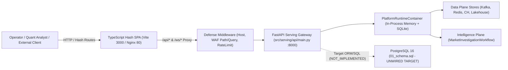

# Application Plane C4 Container Diagram

## 1. Diagram Metadata

| Field | Value |
|---|---|
| **Diagram ID** | `DIAG-APP-C4-001` |
| **Title & Purpose** | Application Plane Container Topology (`AS-IS` Modular Monolith + Target Postgres) |
| **Owner Role & Scope** | `fullstack-engineer / application-plane` |
| **Authoritative Source** | [application-architecture.md](../application-architecture.md) (`APP-ARCH-001`) |
| **Notation** | `Mermaid flowchart LR` (`C4 Container`) |
| **Version & Status** | `2.0.0 — IN_REVIEW` |

## 2. Diagram

## 3. Legend

- **Solid Edges (`-->`)**: Active `AS-IS` synchronous/SSE/WS runtime execution paths.
- **Dashed Edges (`-.->`)**: `TARGET` PostgreSQL persistence declared in `01_schema.sql` with zero runtime SQL driver calls today.
