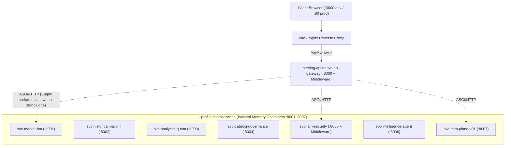

# Application Plane Deployment Topology Diagram

## 1. Diagram Metadata

| Field | Value |
|---|---|
| **Diagram ID** | `DIAG-APP-DEP-001` |
| **Title & Purpose** | Compose Monolith Serving vs Microservices Profile & Vite/Nginx Frontend |
| **Owner Role & Scope** | `devops-sre / application-plane` |
| **Authoritative Source** | [deployment-architecture.md](../deployment-architecture.md) (`APP-ARCH-DEP-001`) |
| **Notation** | `Mermaid flowchart TD` (`Deployment View`) |
| **Version & Status** | `2.0.0 — IN_REVIEW` |

## 2. Diagram

## 3. Legend

- **Port `8000` (`main.py`)**: Default unified FastAPI process serving all routers with shared memory.
- **Ports `8001..8007`**: Standalone microservice FastAPI apps under `docker compose --profile microservices` (all except `8005` lack `install_security_defense_middleware`).
