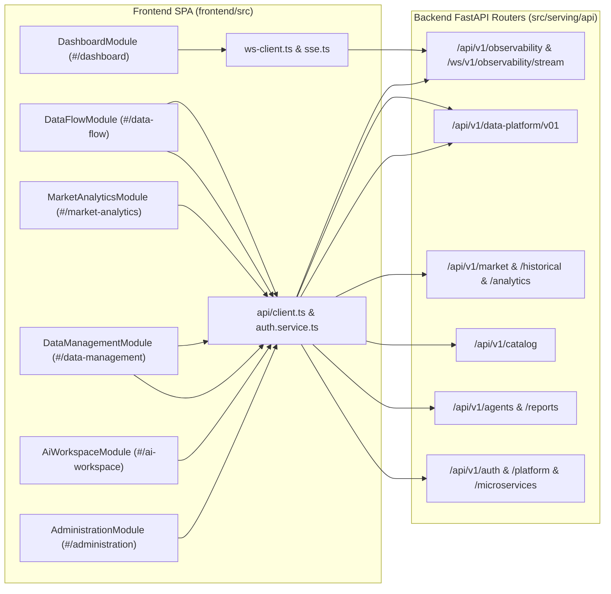

# Application Plane Frontend-to-Backend Component Diagram

## 1. Diagram Metadata

| Field | Value |
|---|---|
| **Diagram ID** | `DIAG-APP-COMP-001` |
| **Title & Purpose** | Frontend SPA Modules to Backend FastAPI Router Decomposition |
| **Owner Role & Scope** | `fullstack-engineer / application-plane` |
| **Authoritative Source** | [frontend-architecture.md](../frontend-architecture.md) (`APP-ARCH-FE-001`) |
| **Notation** | `Mermaid flowchart LR` (`C4 Component`) |
| **Version & Status** | `2.0.0 — IN_REVIEW` |

## 2. Diagram

## 3. Legend

- **Frontend Modules**: Top-level lazy/hash views under `frontend/src/modules/`.
- **Backend Routers**: Domain presentation routers in `src/serving/api/` sharing `PlatformRuntimeContainer`.
