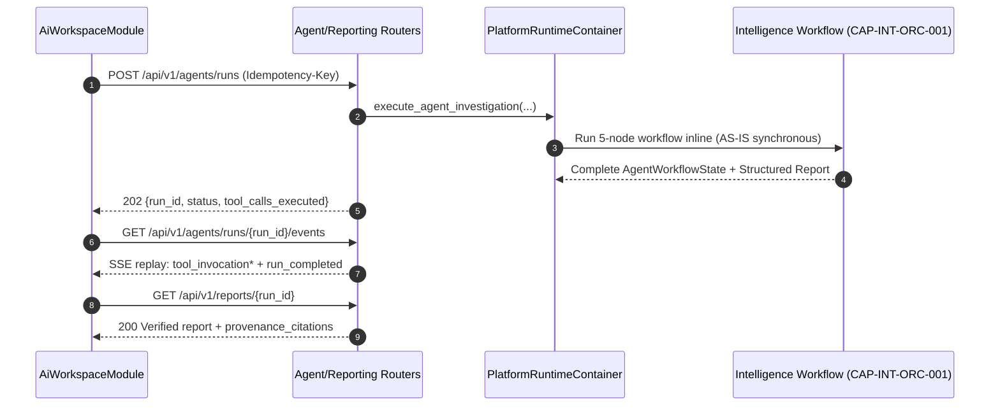

# Sequence Diagram: Agent Investigation Trigger, Replay & Report Fetch

## 1. Diagram Metadata

| Field | Value |
|---|---|
| **Diagram ID** | `DIAG-APP-AGT-SEQ-001` |
| **Title & Purpose** | Portal `POST /agents/runs`, Cross-Plane Execution, SSE Replay & `GET /reports/{run_id}` |
| **Owner Role & Scope** | `fullstack-engineer / CAP-APP-AGT-001` |
| **Authoritative Source** | [uc-agt-001-trigger-and-stream-agent-run.md](../use-cases/uc-agt-001-trigger-and-stream-agent-run.md) (`CAP-APP-AGT-UC-001`) |
| **Notation** | `Mermaid sequenceDiagram` (`UML 2.5.1`) |
| **Version & Status** | `2.0.0 — IN_REVIEW` |

## 2. Diagram

## 3. Legend

- **Inline Synchronous Await**: Step 3 completes entire investigation before HTTP `202` is sent; Step 6 replays stored `evidence_trail`.
