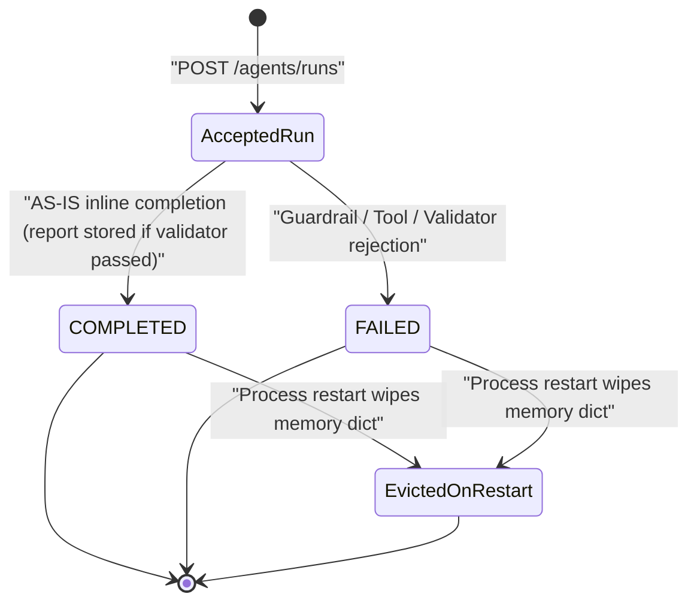

# State Machine Diagram: Portal-Observed Agent Run Lifecycle

## 1. Diagram Metadata

| Field | Value |
|---|---|
| **Diagram ID** | `DIAG-APP-AGT-STATE-001` |
| **Title & Purpose** | Portal Run Ticket & Outcome Visibility States (`GET /agents/runs/{run_id}`) |
| **Owner Role & Scope** | `fullstack-engineer / CAP-APP-AGT-001` |
| **Authoritative Source** | [capability-specification.md](../requirements/capability-specification.md) (`CAP-APP-AGT-REQ-001`) |
| **Notation** | `Mermaid stateDiagram-v2` (`UML 2.5.1`) |
| **Version & Status** | `2.0.0 — IN_REVIEW` |

## 2. Diagram

## 3. Legend

- **Target `QUEUED -> RUNNING`**: Declared in `deploy/postgres/init/01_schema.sql` CHECK constraint but skipped `AS-IS` because execution finishes synchronously before HTTP `202` response.
