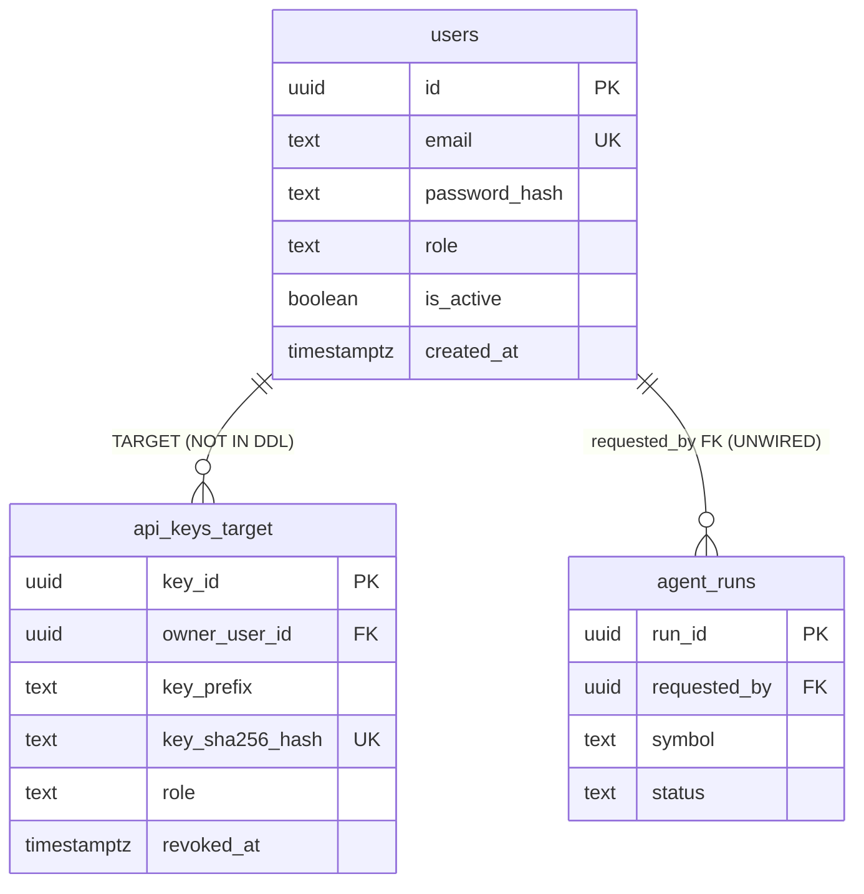

# ERD Diagram: IAM Users, Agent Ownership & Target API Keys

## 1. Diagram Metadata

| Field | Value |
|---|---|
| **Diagram ID** | `DIAG-APP-IAM-ERD-001` |
| **Title & Purpose** | Postgres `users` (Unused `AS-IS` DDL) & Target `api_keys` / `agent_runs` FK Links |
| **Owner Role & Scope** | `database-architect / CAP-APP-IAM-001` |
| **Authoritative Source** | [database-design.md](database-design.md) (`CAP-APP-IAM-DB-001`) |
| **Notation** | `Mermaid erDiagram` (`Crow's Foot`) |
| **Version & Status** | `2.0.0 — DRAFT` |

## 2. Diagram

## 3. Legend

- **`users` & `agent_runs`**: Declared in `deploy/postgres/init/01_schema.sql` with zero runtime SQL queries `AS-IS`.
- **`api_keys_target`**: Missing table required to reconcile `POST/GET/DELETE /api/v1/auth/api-keys`.
