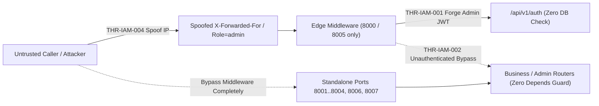

# Threat Model Diagram: Auth Bypass & Edge Defense Boundaries

## 1. Diagram Metadata

| Field | Value |
|---|---|
| **Diagram ID** | `DIAG-APP-IAM-TM-001` |
| **Title & Purpose** | Attack Paths Exploiting Unauthenticated Routes & Self-Hash Token Issuance |
| **Owner Role & Scope** | `security-architect / CAP-APP-IAM-001` |
| **Authoritative Source** | [threat-model.md](threat-model.md) (`CAP-APP-IAM-TM-001`) |
| **Notation** | `Mermaid flowchart LR` (`Threat Model`) |
| **Version & Status** | `2.0.0 — DRAFT` |

## 2. Diagram

## 3. Legend

- **Solid Edges (`-->`)**: Traffic filtered by Host/WAF path+query/rate-limit middleware (`main.py` & `services/iam.py`).
- **Dashed Edges (`-.->`)**: Critical bypass vectors where authentication, RBAC guards, or standalone middleware are absent `AS-IS`.
