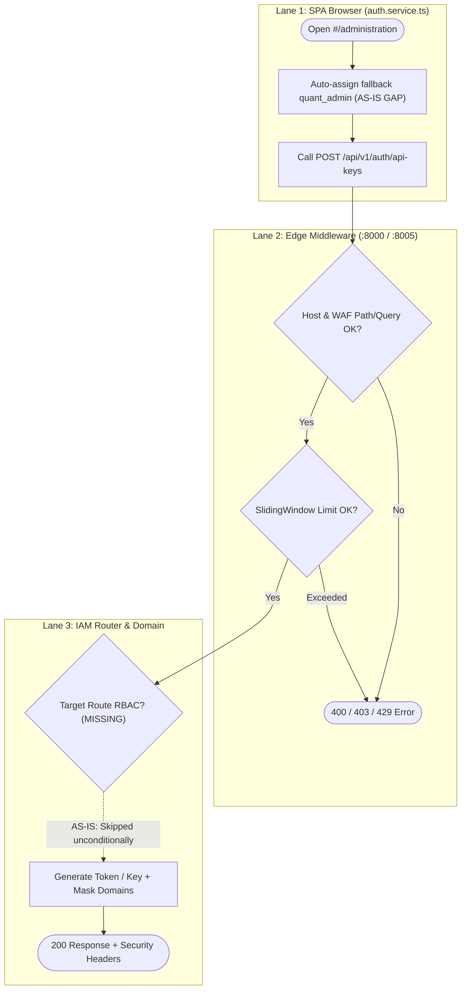

# Cross-Functional Swimlane Flow: HTTP Defense & IAM Control

## 1. Diagram Metadata

| Field | Value |
|---|---|
| **Diagram ID** | `DIAG-APP-IAM-FLOW-001` |
| **Title & Purpose** | Swimlane-Style Request Validation Across SPA, Edge Middleware & IAM Router |
| **Owner Role & Scope** | `business-analyst / CAP-APP-IAM-001` |
| **Authoritative Source** | [uc-iam-003-administer-domains-and-middleware.md](../use-cases/uc-iam-003-administer-domains-and-middleware.md) (`CAP-APP-IAM-UC-003`) |
| **Notation** | `Mermaid Swimlane-style Flowchart (NOT formal BPMN 2.0.2 XML)` |
| **Version & Status** | `2.0.0 — DRAFT` |

## 2. Diagram

## 3. Legend

- **Notation Disclosure**: Uses Mermaid `flowchart TD` with subgraph lanes (`Swimlane-style Flowchart`); not serialized as OMG BPMN 2.0.2 XML.
- **Dashed Transition (`-.->`)**: Documents unauthenticated pass-through into `iam_exec` because route-level RBAC `Depends` is `NOT_IMPLEMENTED`.
