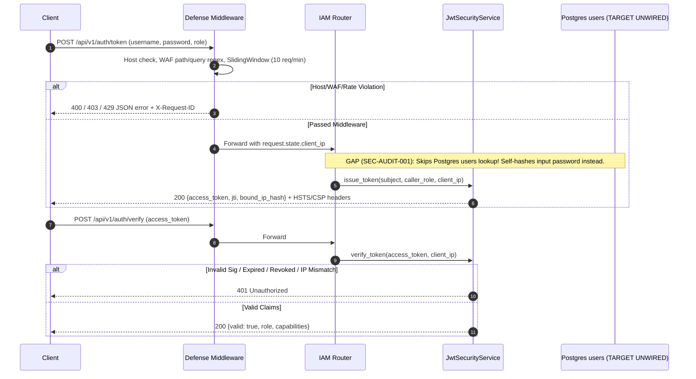

# Sequence Diagram: Edge Middleware, JWT Issuance & Verification

## 1. Diagram Metadata

| Field | Value |
|---|---|
| **Diagram ID** | `DIAG-APP-IAM-SEQ-001` |
| **Title & Purpose** | Edge Middleware, `POST /auth/token` & `POST /auth/verify` Sequence |
| **Owner Role & Scope** | `security-architect / CAP-APP-IAM-001` |
| **Authoritative Source** | [uc-iam-001-issue-and-verify-jwt.md](../use-cases/uc-iam-001-issue-and-verify-jwt.md) (`CAP-APP-IAM-UC-001`) |
| **Notation** | `Mermaid sequenceDiagram` (`UML 2.5.1`) |
| **Version & Status** | `2.0.0 — DRAFT` |

## 2. Diagram

## 3. Legend

- **Lifelines & Boxes**: `MW` and `IAM` reflect exact runtime sequence in `router.py`; `PG` note marks `SEC-AUDIT-001` DB lookup omission.
