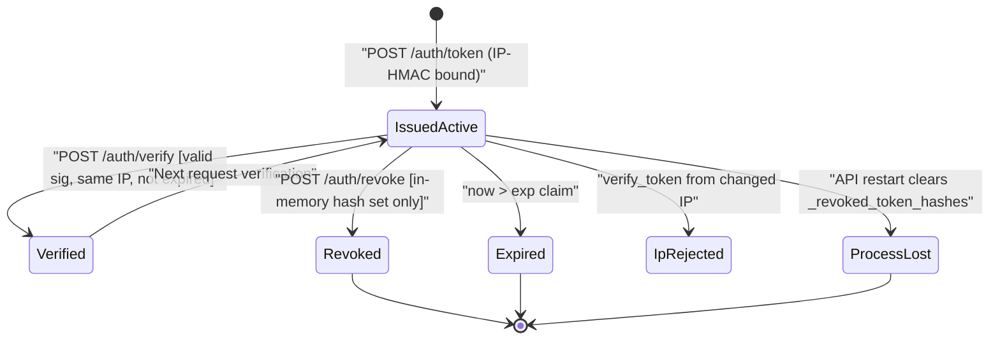

# State Machine Diagram: JWT Token & API Key Lifecycle

## 1. Diagram Metadata

| Field | Value |
|---|---|
| **Diagram ID** | `DIAG-APP-IAM-STATE-001` |
| **Title & Purpose** | HS256 JWT Issuance, IP Verification, Expiration & In-Memory Revocation States |
| **Owner Role & Scope** | `security-architect / CAP-APP-IAM-001` |
| **Authoritative Source** | [capability-specification.md](../requirements/capability-specification.md) (`CAP-APP-IAM-REQ-001`) |
| **Notation** | `Mermaid stateDiagram-v2` (`UML 2.5.1`) |
| **Version & Status** | `2.0.0 — DRAFT` |

## 2. Diagram

## 3. Legend

- **In-Memory Gap**: `Revoked` state is lost upon process restart (`ProcessLost`), allowing non-expired tokens to verify again if signed with the same secret!
