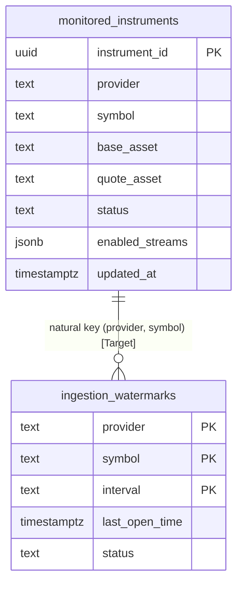

# ERD Diagram: `monitored_instruments` & Watermark Key Mapping

## 1. Diagram Metadata

| Field | Value |
|---|---|
| **Diagram ID** | `DIAG-APP-CAT-ERD-001` |
| **Title & Purpose** | `monitored_instruments` Physical Schema & Natural `(provider, symbol)` Relation |
| **Owner Role & Scope** | `database-architect / CAP-APP-CAT-001` |
| **Authoritative Source** | [database-design.md](database-design.md) (`CAP-APP-CAT-DB-001`) |
| **Notation** | `Mermaid erDiagram` (`Crow's Foot`) |
| **Version & Status** | `2.0.0 — IN_REVIEW` |

## 2. Diagram

## 3. Legend

- **Unwired Relationship**: `monitored_instruments` is defined in `01_schema.sql` without runtime SQL queries; `ingestion_watermarks` uses SQLite WAL `AS-IS`.
