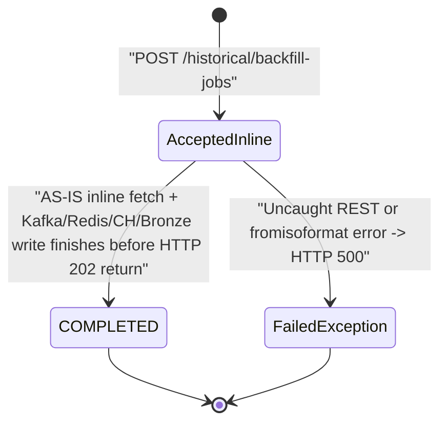

# State Machine Diagram: Backfill Job Execution States (`AS-IS` vs Target)

## 1. Diagram Metadata

| Field | Value |
|---|---|
| **Diagram ID** | `DIAG-APP-MKT-STATE-001` |
| **Title & Purpose** | Backfill Job Lifecycle (`AS-IS` Synchronous `202` vs `TARGET` Queued Worker) |
| **Owner Role & Scope** | `fullstack-engineer / CAP-APP-MKT-001` |
| **Authoritative Source** | [uc-mkt-002-query-klines-trades-and-backfill.md](../use-cases/uc-mkt-002-query-klines-trades-and-backfill.md) (`CAP-APP-MKT-UC-002`) |
| **Notation** | `Mermaid stateDiagram-v2` (`UML 2.5.1`) |
| **Version & Status** | `2.0.0 — IN_REVIEW` |

## 2. Diagram

## 3. Legend

- **`AS-IS` Shortcut**: HTTP `202` returns directly with `"status": "COMPLETED"` in `runtime.backfill_jobs`; asynchronous `QUEUED -> RUNNING -> COMPLETED` worker transitions are `NOT_IMPLEMENTED`.
