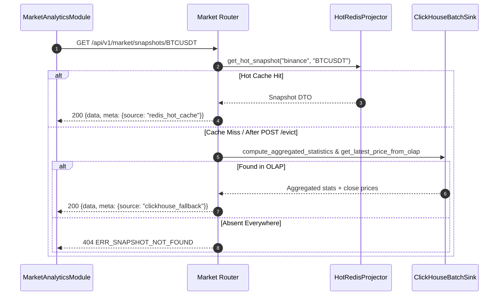

# Sequence Diagram: Hot Redis -> ClickHouse OLAP Read Fallback & Eviction

## 1. Diagram Metadata

| Field | Value |
|---|---|
| **Diagram ID** | `DIAG-APP-MKT-SEQ-001` |
| **Title & Purpose** | Cache Hit vs Evicted OLAP Fallback for `/market/snapshots/{symbol}` |
| **Owner Role & Scope** | `fullstack-engineer / CAP-APP-MKT-001` |
| **Authoritative Source** | [uc-mkt-001-query-hot-market-and-orderbook.md](../use-cases/uc-mkt-001-query-hot-market-and-orderbook.md) (`CAP-APP-MKT-UC-001`) |
| **Notation** | `Mermaid sequenceDiagram` (`UML 2.5.1`) |
| **Version & Status** | `2.0.0 — IN_REVIEW` |

## 2. Diagram

## 3. Legend

- **`meta.source`**: Explicitly reveals whether data came from `redis_hot_cache` or `clickhouse_fallback` (except `GET /orderbook/{symbol}` which always labels `"redis_hot_cache"` even on static fallback).
