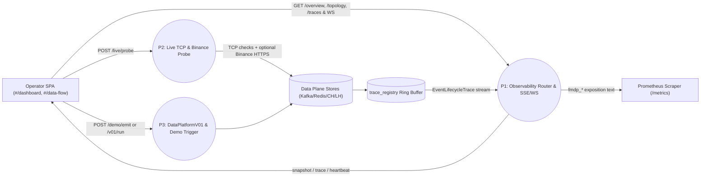

# Data Flow Diagram: Live Observability Telemetry & Control Flows

## 1. Diagram Metadata

| Field | Value |
|---|---|
| **Diagram ID** | `DIAG-APP-OPS-DFD-001` |
| **Title & Purpose** | Telemetry Collection, TCP Probe & SSE/WS Push Flows |
| **Owner Role & Scope** | `fullstack-engineer / CAP-APP-OPS-001` |
| **Authoritative Source** | [component-design.md](component-design.md) (`CAP-APP-OPS-COMP-001`) |
| **Notation** | `Mermaid flowchart LR` (`Yourdon/Gane-Sarson DFD`) |
| **Version & Status** | `2.0.0 — IN_REVIEW` |

## 2. Diagram

## 3. Legend

- **Circles (`((...))`)**: Telemetry and control execution processes.
- **Cylinders (`[(...)]`)**: In-memory ring buffers (`trace_registry`) and backing Data Plane stores.
