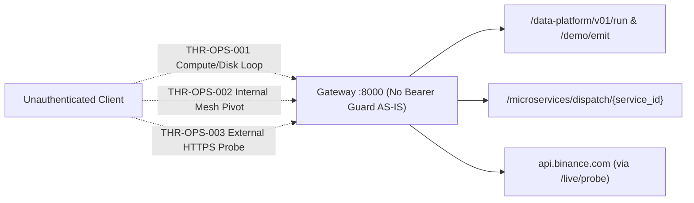

# Threat Model Diagram: Unauthenticated Ops Control & Dispatch Surface

## 1. Diagram Metadata

| Field | Value |
|---|---|
| **Diagram ID** | `DIAG-APP-OPS-TM-001` |
| **Title & Purpose** | Attack Surface on Unauthenticated Pipeline Triggers & Internal ASGI Dispatch |
| **Owner Role & Scope** | `security-architect / CAP-APP-OPS-001` |
| **Authoritative Source** | [threat-model.md](threat-model.md) (`CAP-APP-OPS-TM-001`) |
| **Notation** | `Mermaid flowchart LR` (`Threat Model`) |
| **Version & Status** | `2.0.0 — DRAFT` |

## 2. Diagram

## 3. Legend

- **Dashed Arrows (`-.->`)**: Unauthenticated routes exposed `AS-IS` without `Depends` authorization enforcement.
