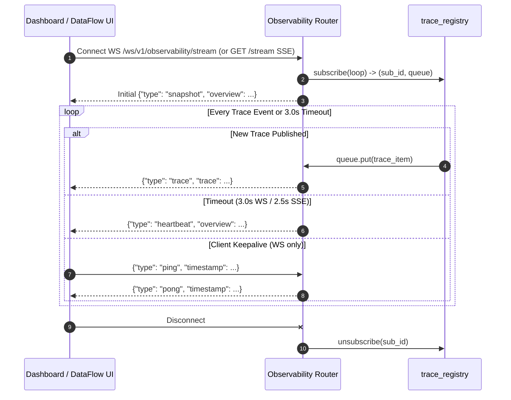

# Sequence Diagram: WebSocket & SSE Live Observability Subscription

## 1. Diagram Metadata

| Field | Value |
|---|---|
| **Diagram ID** | `DIAG-APP-OPS-SEQ-001` |
| **Title & Purpose** | WebSocket `/ws/v1/observability/stream` & SSE `/api/v1/observability/stream` Protocol |
| **Owner Role & Scope** | `fullstack-engineer / CAP-APP-OPS-001` |
| **Authoritative Source** | [uc-ops-001-dashboard-live-probe-and-streams.md](../use-cases/uc-ops-001-dashboard-live-probe-and-streams.md) (`CAP-APP-OPS-UC-001`) |
| **Notation** | `Mermaid sequenceDiagram` (`UML 2.5.1`) |
| **Version & Status** | `2.0.0 — IN_REVIEW` |

## 2. Diagram

## 3. Legend

- **Queue Isolation**: Each connected subscriber receives its own `asyncio.Queue`; `finally` guarantees cleanup on client disconnect.
