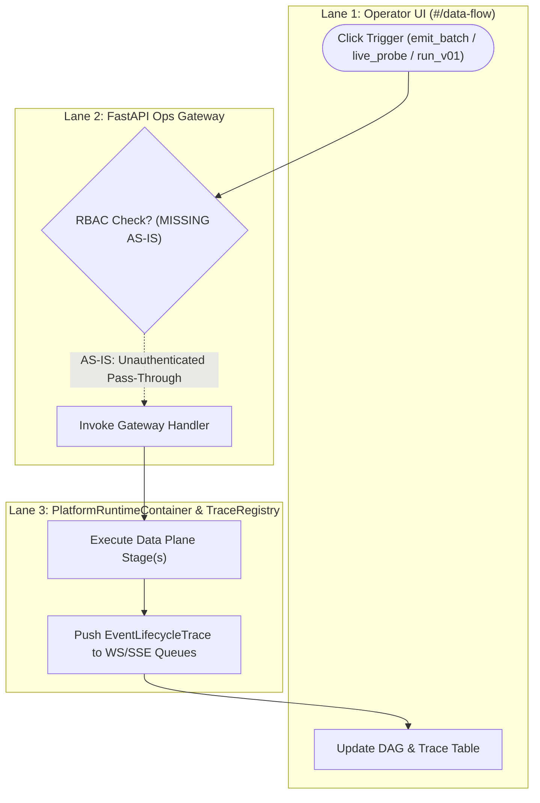

# Cross-Functional Swimlane Flow: Operator Telemetry & Control Trigger

## 1. Diagram Metadata

| Field | Value |
|---|---|
| **Diagram ID** | `DIAG-APP-OPS-FLOW-001` |
| **Title & Purpose** | Swimlane-Style Control Execution (`demo/emit`, `live/probe`, `data-platform/v01/run`) |
| **Owner Role & Scope** | `business-analyst / CAP-APP-OPS-001` |
| **Authoritative Source** | [uc-ops-002-data-flow-dag-traces-and-simulation.md](../use-cases/uc-ops-002-data-flow-dag-traces-and-simulation.md) (`CAP-APP-OPS-UC-002`) |
| **Notation** | `Mermaid Swimlane-style Flowchart (NOT formal BPMN 2.0.2 XML)` |
| **Version & Status** | `2.0.0 — DRAFT` |

## 2. Diagram

## 3. Legend

- **Notation Disclosure**: Uses Mermaid `flowchart TD` with subgraph lanes (`Swimlane-style Flowchart`); not OMG BPMN 2.0.2 XML.
