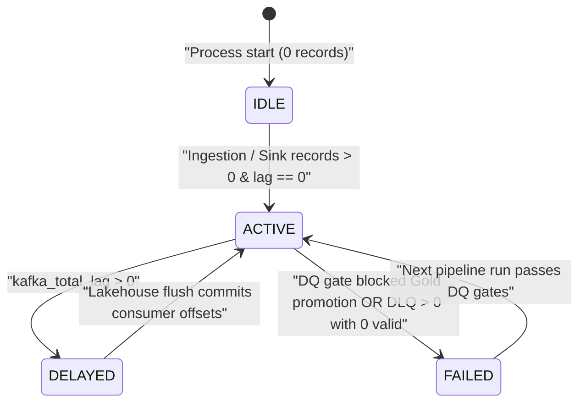

# State Machine Diagram: Topology Node & Event Trace Lifecycle

## 1. Diagram Metadata

| Field | Value |
|---|---|
| **Diagram ID** | `DIAG-APP-OPS-STATE-001` |
| **Title & Purpose** | 12-Node Topology Node Operational States (`runtime.py:1224-1381`) |
| **Owner Role & Scope** | `devops-sre / CAP-APP-OPS-001` |
| **Authoritative Source** | [capability-specification.md](../requirements/capability-specification.md) (`CAP-APP-OPS-REQ-001`) |
| **Notation** | `Mermaid stateDiagram-v2` (`UML 2.5.1`) |
| **Version & Status** | `2.0.0 — IN_REVIEW` |

## 2. Diagram

## 3. Legend

- **Node Statuses**: Computed dynamically in `get_observability_topology()` (`ACTIVE`, `IDLE`, `DELAYED`, `FAILED`) and `UNAVAILABLE` for Kafka Brokers 2 & 3.
