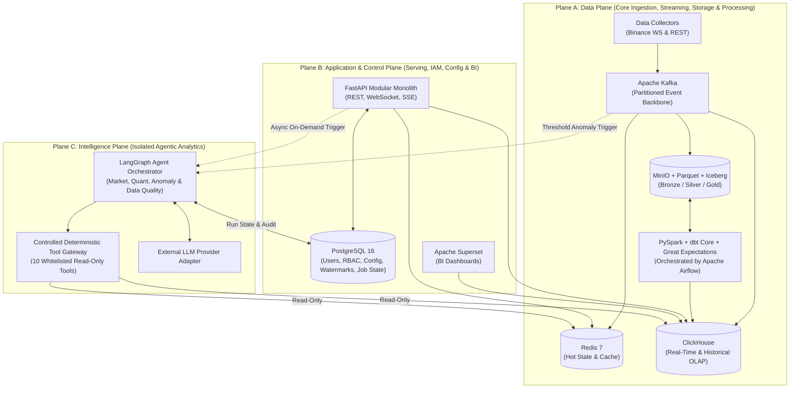

# 00 — Architecture Overview & Executive Blueprint

## 1. Architectural Vision & Paradigm

The **Real-time Financial Market Data Platform** is engineered as an **Event-Driven Data Platform with a Streaming-First Hybrid Lakehouse Architecture**, paired with a **Modular Monolith Backend (Clean/Hexagonal Architecture + Selective CQRS)** and an **Isolated Agentic Intelligence Plane**.

The architecture is governed by seven core engineering objectives:
1. **O1 — High-Performance Data Access**: Workload-segregated routing across Redis (sub-15ms hot state), ClickHouse (sub-100ms historical/analytical OLAP), PostgreSQL (transactional control plane), and MinIO/Iceberg (historical Lakehouse).
2. **O2 — Real-Time Data Processing**: Partition-ordered Apache Kafka event streaming with at-least-once delivery, idempotent consumers, monotonic state protection, and dead-letter routing.
3. **O3 — Scalable Data Infrastructure**: Independent scaling and process isolation between WebSocket collectors, streaming consumers, batch Spark/dbt jobs, FastAPI HTTP workers, and AI Agent workers.
4. **O4 — Reliable Data Processing**: End-to-end schema contracts, deterministic UUIDv5 deduplication, `ReplacingMergeTree` eventual deduplication, PySpark `MERGE INTO` ACID Lakehouse tables, and Great Expectations quality gates.
5. **O5 — Maintainable Backend Architecture**: Modular Monolith organized by business domains (`market`, `historical`, `analytics`, `catalog`, `iam`, `platform_config`, `agent_api`, `reporting`) enforcing inward Clean/Hexagonal dependency rules.
6. **O6 — Agentic Analytics Integration**: Stateful LangGraph orchestration isolated in an Intelligence Plane that accesses data exclusively via a read-only deterministic Tool Gateway.
7. **O7 — Resource Efficiency**: Designed for local and single-host deployment via Docker Compose profiles (`core`, `lakehouse`, `intelligence`, `observability`, `bi`) without premature Kubernetes or microservice complexity.

---

## 2. The Three Architectural Planes

### Plane Isolation & Unidirectional Dependency Invariant
- **Plane A (Data Plane)** never depends on Plane C (Intelligence Plane). If all LLM providers are unreachable or `agent-worker` is stopped, market data ingestion, streaming, storage, and API serving continue operating at 100% capacity.
- **Plane B (Application & Control Plane)** reads optimized projections from Plane A (`Redis`, `ClickHouse`), manages control state in `PostgreSQL`, and triggers Plane C runs asynchronously (`HTTP 202 Accepted`).
- **Plane C (Intelligence Plane)** is strictly read-only with respect to financial data; it can only invoke whitelisted deterministic tools through the Tool Gateway and write its own audit/report state to `PostgreSQL`.

---

## 3. Approved Technology Baseline & Role Matrix

| Architectural Layer | Technology | Strictly Defined Responsibility | Explicit Non-Responsibility |
|---|---|---|---|
| **Language & Runtime** | Python 3.12+ | Collectors, Kafka consumers, FastAPI backend, PySpark jobs, LangGraph agent | Not used for ad-hoc unvalidated scripts bypassing contracts |
| **Query Language** | SQL | ClickHouse OLAP queries, dbt transformations, PostgreSQL control queries | Never dynamically generated as unrestricted raw SQL by LLMs |
| **Data Sources** | Binance WS & REST APIs | Initial real-time and historical spot market data | Normalized at collector edge; never leaked into internal domain models |
| **Event Streaming** | Apache Kafka (KRaft) | Durable event ingestion, partitioning by `{provider}:{symbol}`, consumer fan-out | Not a permanent historical database (retention capped at 24h–72h) |
| **Hot Cache & State** | Redis 7 | Latest prices, 24h snapshots, top-20 order book, short-TTL query cache, rate limits | **Not a system of record**; never stores historical time-series arrays |
| **Analytical OLAP DB** | ClickHouse | Sub-second historical candle/trade queries, Materialized Views, Superset serving | Not used for OLTP user accounts, RBAC, or frequent row-level mutations |
| **Transactional OLTP DB** | PostgreSQL 16 | Users, RBAC, API keys, platform config, watermarks, Airflow & Agent run state | Never stores high-volume market tick or kline streams |
| **Object Storage** | MinIO (S3 API) | Durable Data Lake storage for Bronze, Silver, and Gold datasets | Never queried synchronously by low-latency FastAPI endpoints |
| **File & Table Format** | Apache Parquet + Apache Iceberg | ZSTD columnar storage with ACID table snapshots, schema evolution, and compaction | Does not replace ClickHouse as a low-latency query engine |
| **Batch Processing** | Apache Spark (PySpark) | Bronze $\rightarrow$ Silver deduplication, historical backfills, Iceberg maintenance | Never used on the per-event real-time hot path or synchronous API path |
| **Data Transformation** | dbt Core | Versioned SQL modeling (Silver $\rightarrow$ Gold and ClickHouse analytical marts) | Not a streaming engine |
| **Orchestration** | Apache Airflow | Scheduling batch jobs, historical backfills, dbt runs, and GE validations | Never used as a real-time event broker |
| **Data Quality** | Great Expectations | Automated data contract assertions on Silver/Gold Iceberg and ClickHouse tables | Not a replacement for producer-side Pydantic schema validation |
| **Backend Framework** | FastAPI | Modular Monolith REST, WebSocket, and SSE API layer | Never executes heavy CPU math or long-running workflows on the event loop |
| **BI & Visualization** | Apache Superset | Interactive analytical dashboards over ClickHouse read models | Not used for operational service monitoring (handled by Grafana) |
| **Observability** | Prometheus + Grafana | Metrics scraping, consumer lag tracking, API latency histograms, alerting | Not a business BI tool |
| **Agent Orchestration** | LangGraph | Stateful multi-step investigation workflows and tool orchestration | Isolated from core ingestion; never performs financial arithmetic in prompts |
| **Packaging & Local Ops** | Docker + Docker Compose | Containerized service packaging and profiled local orchestration | No Kubernetes complexity in initial deployment |
| **CI/CD & VCS** | Git + GitHub Actions | Automated linting, architecture boundary tests, unit/contract tests | — |

---

## 4. Architectural Limitations & Non-Negotiable Boundaries Summary

Every architectural pattern in this platform has explicit boundaries documented in detail across Sections `04`–`13` and `ADR-001`–`ADR-006`:
1. **No Premature Microservices**: The backend is a Modular Monolith (`backend-api`) plus independent workers (`collector-ws`, `collector-rest`, `consumer-*`, `agent-worker`).
2. **At-Least-Once + Idempotency (No Distributed 2PC Assumption)**: Kafka producers and consumers assume duplicates can happen and enforce deterministic deduplication at every sink.
3. **Selective CQRS Without Event Sourcing**: CQRS is applied only to high-volume market/analytics domains; control plane domains use straightforward ACID PostgreSQL repositories.
4. **Lakehouse Is Not a Low-Latency API Engine**: FastAPI never queries MinIO/Parquet synchronously.
5. **Spark & Airflow Are Strictly Batch**: Neither Spark nor Airflow sits on the real-time per-event path.
6. **Redis Resilience**: If Redis is evicted or offline, `MarketQueryService` transparently falls back to ClickHouse with circuit-breaker rate protection.
7. **Deterministic Tools Over LLM Math**: The LLM never executes raw SQL or calculates financial metrics; all math is performed by deterministic Python/ClickHouse tools in the Tool Gateway.

---

## 5. Phased Implementation Roadmap (Phases 0 to 5)

### Phase 0 — Architecture Foundation (Current Task)
- **Objective**: Establish complete system/data/backend/agent architecture, ADRs, specifications, diagrams, and initial modular project scaffolding.
- **Scope**: Repository discovery, requirement analysis, 14 architecture docs, 16 diagrams, 6 ADRs, 5 specifications, Docker Compose profiled blueprint, clean-architecture package skeleton, and automated architectural boundary tests.
- **Required Components**: Documentation suite (`docs/`), Python project skeleton (`src/`), `docker-compose.yml`, `pyproject.toml`, `.env.example`, and `tests/architecture/`.
- **Dependencies**: None (greenfield initialization preserving existing repository files).
- **Deliverables**: All files listed in Section 12 and Section 13.
- **Acceptance Criteria**: All 16 diagrams and 6 ADRs complete; architectural boundary tests pass via `pytest`.
- **Risks**: Over-scaffolding speculative features; mitigated by keeping initial code strictly focused on contracts, ports, entrypoints, and structural verification.

### Phase 1 — Data Foundation
- **Objective**: Implement working real-time and historical ingestion from Binance into Kafka and ClickHouse with foundational data quality.
- **Scope**: `collector-ws`, `collector-rest`, Kafka topic provisioning, Pydantic event validation, DLQ routing, `consumer-analytics-ch`, ClickHouse base tables (`market_trades`, `market_klines`, `market_tickers`, `order_book_snapshots`), and basic Great Expectations checks.
- **Required Components**: `src/collectors/`, `src/consumers/analytics_ch/`, `deploy/clickhouse/init/`, Kafka broker.
- **Dependencies**: Phase 0 contracts and Docker Compose `core` profile.
- **Deliverables**: Live ingestion of top 10 spot symbols into ClickHouse with $<5\text{ s}$ end-to-end lag and zero unvalidated events.
- **Acceptance Criteria**: Sustained 30-minute ingestion run with automatic WebSocket reconnect recovery and verified `ReplacingMergeTree` deduplication.
- **Risks**: Binance WebSocket disconnects or rate-limit bans (`HTTP 429/418`); mitigated by token-bucket rate limiters and exponential backoff with jitter.

### Phase 2 — Data Platform (Medallion Lakehouse & Batch Orchestration)
- **Objective**: Build the Bronze–Silver–Gold Lakehouse on MinIO/Iceberg orchestrated by Apache Airflow.
- **Scope**: `consumer-lakehouse-bronze`, Iceberg catalog setup, PySpark Bronze-to-Silver deduplication jobs, dbt Core Silver-to-Gold models and ClickHouse marts, Great Expectations validation suites, and historical backfill DAGs.
- **Required Components**: `src/consumers/lakehouse_bronze/`, `src/processing/spark/`, `src/transformation/dbt/`, `src/quality/`, `deploy/airflow/dags/`, MinIO.
- **Dependencies**: Phase 1 Kafka streams and REST collector watermarks.
- **Deliverables**: Automated Airflow DAGs producing validated Silver and Gold Iceberg tables and historical ClickHouse backfills.
- **Acceptance Criteria**: Re-running any historical backfill or PySpark Silver job over the same time window is 100% idempotent (zero duplicate rows).
- **Risks**: Small-file proliferation in MinIO; mitigated by 5-minute / 64MB buffer thresholds and scheduled Iceberg compaction.

### Phase 3 — High-Performance Backend & BI
- **Objective**: Deliver the production-grade FastAPI Modular Monolith, Redis Hot Path, WebSocket live streaming, and Apache Superset dashboards.
- **Scope**: `consumer-hot-redis` (with Lua monotonic scripts), FastAPI domain modules (`market`, `historical`, `analytics`, `catalog`, `iam`, `platform_config`), Redis-to-ClickHouse fallback circuit breaker, WebSocket multiplexer, and Superset dashboards.
- **Required Components**: `src/consumers/hot_redis/`, `src/backend/`, PostgreSQL migrations, Redis, Superset.
- **Dependencies**: Phase 1 ClickHouse tables and Kafka topics.
- **Deliverables**: Versioned `/api/v1/*` and `/ws/v1/*` endpoints meeting P95 latency baselines.
- **Acceptance Criteria**: Load test confirms P95 $<15\text{ ms}$ for hot price reads, P95 $<80\text{ ms}$ for bounded historical candle queries, and seamless fallback when Redis container is paused.
- **Risks**: Slow analytical queries blocking FastAPI workers; mitigated by strict query window validation and async ClickHouse driver timeouts.

### Phase 4 — Agentic Intelligence
- **Objective**: Deploy the isolated LangGraph Agent Service, Controlled Tool Gateway, and anomaly-triggered investigation workflows.
- **Scope**: `MarketIntelligenceGraph`, 10 deterministic tools in `src/agent/tools/`, `StatisticalAnomalyDetector`, `agent-worker`, PostgreSQL run/tool audit persistence, SSE progress streaming, and token budget circuit breakers.
- **Required Components**: `src/agent/`, `src/backend/modules/agent_api/`, `src/backend/modules/reporting/`.
- **Dependencies**: Phase 3 read adapters (Redis & ClickHouse) and PostgreSQL state tables.
- **Deliverables**: On-demand and anomaly-triggered structured market intelligence reports with 100% deterministic quantitative citations.
- **Acceptance Criteria**: Every numeric metric in generated reports matches deterministic tool outputs; stopping or breaking the LLM adapter has zero effect on Phase 1–3 components.
- **Risks**: Runaway LLM loops or token spikes; mitigated by `max_iterations=6`, `90s` hard timeout, and 15-minute per-symbol anomaly cooldowns.

### Phase 5 — Production Readiness & Operational Hardening
- **Objective**: Harden security, observability, failure recovery, CI/CD pipelines, and performance benchmarks.
- **Scope**: Prometheus/Grafana dashboards and alert rules, full RBAC and secret rotation verification, chaos/recovery tests (Kafka replay, ClickHouse rebuild from Iceberg), load testing, and operational runbooks.
- **Required Components**: `.github/workflows/`, `deploy/prometheus/`, `deploy/grafana/`, `tests/load/`, `docs/architecture/11-reliability-and-observability.md`.
- **Dependencies**: Phases 1–4.
- **Deliverables**: Automated CI/CD pipeline, benchmark report finalizing NFR targets, backup/restore scripts, and incident runbooks.
- **Acceptance Criteria**: All unit, architectural, contract, integration, and recovery tests pass in CI; zero high/critical security findings.
- **Risks**: Host resource contention when all profiles run simultaneously; mitigated by documented container memory/CPU limits and profile segregation.

