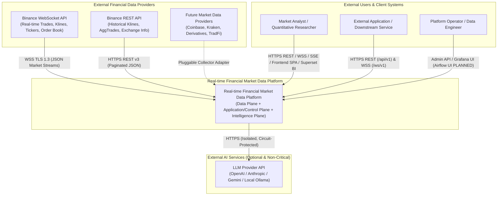

# 01 — System Context Architecture (C4 Level 1)

## 1. System Scope & Context

The **Real-time Financial Market Data Platform** sits between external financial liquidity venues (initially **Binance Spot REST and WebSocket APIs**, extensible to additional exchanges and asset classes) and downstream consumers (Market Analysts, External Trading/Analytics Applications, BI Dashboards, and Platform Operators).

See also: [Diagram 01: System Context Diagram](../diagrams/system/01-system-context.md).

---

## 2. External Actors & Interfaces

| External Actor / System | Direction | Protocol & Authentication | Interaction Summary | Implementation Status / Availability Assumption |
|---|---|---|---|---|
| **Binance WebSocket API** | Inbound (Stream) | `wss://stream.binance.com:9443/ws` (Public market streams; TLS 1.3) | Pushes live `trade`, `kline_<interval>`, `ticker`, and `depth20` events. | `PARTIALLY_IMPLEMENTED`: `BinancePayloadNormalizer` active; standalone `collector-ws` daemon loop is an entrypoint stub while REST probes supply live frames. |
| **Binance REST API** | Outbound Request / Inbound Data | `https://api.binance.com/api/v3/*` (HTTPS; optional API Key for higher rate weight) | Serves historical `klines`, `aggTrades`, `depth` snapshots, and `exchangeInfo`. | `IMPLEMENTED`: `ProductionExchangeHistoricalCollector` and `/api/v1/observability/live/probe` execute HTTPS fetches with token-bucket rate limit handling. |
| **Future Data Providers** | Inbound | Provider-specific REST / WebSocket / FIX | Additional crypto or traditional exchanges extensible behind provider adapters. | `PLANNED`: Multi-provider normalization pattern designed; Binance Spot implemented in `v0.1`. |
| **External LLM Provider** | Outbound Request | HTTPS REST (API Key via environment secret) | Used exclusively by the Intelligence Plane to plan deterministic tool calls and synthesize narrative reports. | `PARTIALLY_IMPLEMENTED` (**Non-Critical**): Deterministic mock/fallback adapter (`DeterministicMockLLMAdapter`) runs offline when no LLM API key is configured. |
| **Market Analyst / Trader** | Inbound / Outbound | HTTPS (`/api/v1/*`, SPA `frontend:3001`), WSS (`/ws/v1/observability/stream`), SSE (`/api/v1/observability/stream`, `/api/v1/agents/runs/{run_id}/events`) | Views live observatory telemetry, prices, historical candles, analytics, and on-demand Agent reports (`WS /ws/v1/market/stream` is `PLANNED`, Superset dashboards `PLANNED`). | `PARTIALLY_IMPLEMENTED`: Observatory SPA + REST/SSE/WS endpoints active; SPA path drift tracked in `PROP-APP-001`. |
| **External Client Application** | Inbound / Outbound | HTTPS REST & WebSocket (`X-API-Key` or Bearer JWT) | Integrates normalized market prices, candles, and analytics into downstream systems. | `PARTIALLY_IMPLEMENTED`: Sliding-window rate limits active; IAM issues JWT/API keys, while domain-route RBAC enforcement is pending (`PROP-APP-004`). |
| **Platform Operator / Data Engineer** | Inbound / Outbound | Admin/Observability API, Grafana UI (`:3000`), Airflow UI (`PLANNED`) | Configures monitored symbols, triggers `v01` pipelines/backfills, monitors Kafka/storage telemetry and Grafana panels. | `PARTIALLY_IMPLEMENTED`: APIs and Compose `observability` profile defined; standalone `airflow` container is `PLANNED`. |

---

## 3. Multi-Provider Extensibility Boundary

To satisfy Requirement `2.2` (*"support adding other providers without requiring substantial modifications to the entire Data Platform"*), provider-specific formats are terminated strictly inside `src/ingestion/providers/<provider_name>/`:

1. **Symbol Normalization**: Exchange-specific symbols (`BTC-USDT`, `XBT/USD`, `btcusdt`) are mapped via the `monitored_instruments` catalog into canonical uppercase symbols (`BTCUSDT`) paired with explicit `provider` (`binance`, `coinbase`, etc.).
2. **Timestamp & Precision Normalization**: Exchange timestamps (seconds, milliseconds, microseconds, or ISO strings) are converted to UTC millisecond `DateTime64(3, 'UTC')`, and all monetary strings/floats are parsed into exact `Decimal` strings before leaving the collector.
3. **Storage & Partition Key Readiness**: Every Kafka partition key (`{provider}:{symbol}`), Redis key (`market:v1:price:{provider}:{symbol}`), ClickHouse sorting key `(provider, symbol, ...)`, and Iceberg table schema already includes `provider` as a first-class column.

