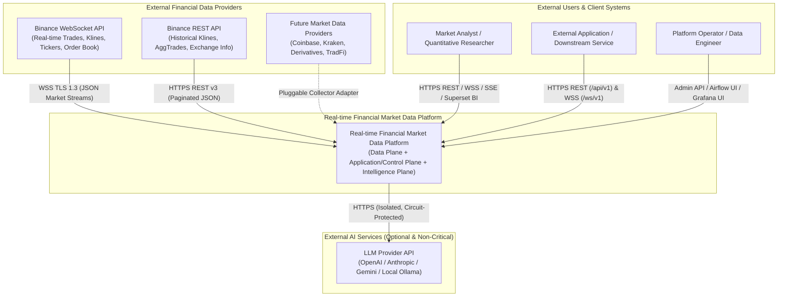

# 01 — System Context Architecture (C4 Level 1)

## 1. System Scope & Context

The **Real-time Financial Market Data Platform** sits between external financial liquidity venues (initially **Binance Spot REST and WebSocket APIs**, extensible to additional exchanges and asset classes) and downstream consumers (Market Analysts, External Trading/Analytics Applications, BI Dashboards, and Platform Operators).

See also: [Diagram 01: System Context Diagram](../diagrams/system/01-system-context.md).

---

## 2. External Actors & Interfaces

| External Actor / System | Direction | Protocol & Authentication | Interaction Summary | Failure / Availability Assumption |
|---|---|---|---|---|
| **Binance WebSocket API** | Inbound (Stream) | `wss://stream.binance.com:9443/ws` (Public market streams; TLS 1.3) | Pushes live `trade`, `kline_<interval>`, `ticker`, and `depth20` events. | Connections drop periodically (24h max lifetime or network jitter); collector must auto-reconnect and trigger gap backfill. |
| **Binance REST API** | Outbound Request / Inbound Data | `https://api.binance.com/api/v3/*` (HTTPS; optional API Key for higher rate weight) | Serves historical `klines`, `aggTrades`, `depth` snapshots, and `exchangeInfo`. | Enforces strict IP/UID request weight limits (`HTTP 429` / `418`); collector must enforce token-bucket rate limiting. |
| **Future Data Providers** | Inbound | Provider-specific REST / WebSocket / FIX | Additional crypto or traditional exchanges integrated via the `MarketDataProviderPort` interface. | Provider-specific anomalies isolated at collector edge; canonical platform schemas remain unchanged. |
| **External LLM Provider** | Outbound Request | HTTPS REST (API Key via environment secret) | Used exclusively by the Intelligence Plane to plan deterministic tool calls and synthesize narrative reports. | **Untrusted & Non-Critical**: May experience high latency, rate limits, or total outage. Core platform must operate 100% when unavailable. |
| **Market Analyst / Trader** | Inbound / Outbound | HTTPS (`/api/v1/*`), WSS (`/ws/v1/*`), SSE, Superset UI (JWT Auth) | Views live prices, historical charts, quantitative metrics, BI dashboards, and requests on-demand Agent reports. | Requires bounded response latencies and explicit data staleness indicators (`is_stale`). |
| **External Client Application** | Inbound / Outbound | HTTPS REST & WebSocket (`X-API-Key` or Bearer JWT) | Integrates normalized market prices, candles, and analytics into downstream systems. | Subject to strict per-key sliding-window rate limits and query range caps. |
| **Platform Operator / Data Engineer** | Inbound / Outbound | Admin API (`role=operator/admin`), Airflow UI, Grafana UI | Configures monitored symbols, triggers historical backfills, monitors consumer lag, and inspects data quality alerts. | Audited via PostgreSQL control-plane logs. |

---

## 3. Multi-Provider Extensibility Boundary

To satisfy Requirement `2.2` (*"support adding other providers without requiring substantial modifications to the entire Data Platform"*), provider-specific formats are terminated strictly inside `src/collectors/providers/<provider_name>/`:

1. **Symbol Normalization**: Exchange-specific symbols (`BTC-USDT`, `XBT/USD`, `btcusdt`) are mapped via the `monitored_instruments` catalog into canonical uppercase symbols (`BTCUSDT`) paired with explicit `provider` (`binance`, `coinbase`, etc.).
2. **Timestamp & Precision Normalization**: Exchange timestamps (seconds, milliseconds, microseconds, or ISO strings) are converted to UTC millisecond `DateTime64(3, 'UTC')`, and all monetary strings/floats are parsed into exact `Decimal` strings before leaving the collector.
3. **Storage & Partition Key Readiness**: Every Kafka partition key (`{provider}:{symbol}`), Redis key (`market:v1:price:{provider}:{symbol}`), ClickHouse sorting key `(provider, symbol, ...)`, and Iceberg table schema already includes `provider` as a first-class column.

