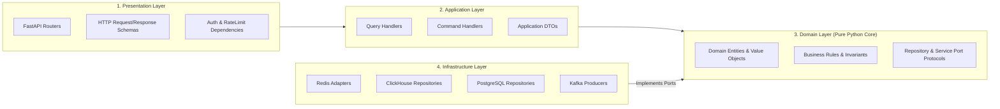

# 05 — Backend Architecture

## 1. Architectural Style: Modular Monolith + Independent Workers

In accordance with Requirement `6.1` and `ADR-004`, the backend adopts a **Modular Monolith + Independently Deployable Workers + Dedicated Agent Service** topology.

See also:
- [Diagram 08: Backend Module Architecture](../diagrams/backend/08-backend-module-architecture.md)
- [Diagram 09: Backend Request Lifecycle](../diagrams/backend/09-backend-request-lifecycle.md)
- [Diagram 10: CQRS Read/Write Architecture](../diagrams/backend/10-cqrs-read-write.md)

### 1.1. Why Not Distributed Microservices Initially?
- **Network & Operational Overhead**: Splitting 8 internal domains into 8 HTTP/gRPC microservices adds serialization latency, distributed failure modes, duplicated connection pools to Redis/ClickHouse/PostgreSQL, and unnecessary container memory overhead.
- **Criteria for Future Service Extraction**: A domain module inside `src/backend/modules/` is extracted into a standalone deployable service **only** when measured evidence demonstrates:
  1. Independent horizontal scaling requirements (e.g., WebSocket streaming fan-out to 10,000+ concurrent clients),
  2. Distinct compute/memory resource profiles (already satisfied by isolating Collectors, Consumers, Spark, and Agent Workers), or
  3. Independent team ownership and release cadence.

---

## 2. Business Domain Modules (`src/backend/modules/`)

The FastAPI application is partitioned into eight bounded domain modules:

| Domain Module | Package Path | Primary Responsibilities | Backing Stores | CQRS Applied? |
|---|---|---|---|---|
| **1. Market** | `src/backend/modules/market/` | Real-time latest prices, 24h rolling snapshots, top-20 order book depth, and live WebSocket streaming (`/ws/v1/market/stream`). | Redis (Primary) + ClickHouse (Fallback) | **Yes** (Read-Only Projection) |
| **2. Historical Data** | `src/backend/modules/historical/` | Bounded time-series queries for historical klines/OHLCV and executed trades; asynchronous backfill job submission and watermark tracking. | ClickHouse (Reads) + PostgreSQL (Backfill Jobs) | **Yes** (Read Projection + Async Command) |
| **3. Analytics** | `src/backend/modules/analytics/` | Rolling market statistics, realized volatility, return distributions, cross-symbol correlation matrices, and detected anomaly queries. | ClickHouse Base & Materialized Views + Redis Cache-Aside | **Yes** (Read-Only Analytical Projection) |
| **4. Data Catalog** | `src/backend/modules/catalog/` | Instrument metadata registry (`monitored_instruments`), dataset schema catalog, and real-time data freshness / consumer lag status. | PostgreSQL + Redis/ClickHouse Freshness Probes | Partial (CRUD + Freshness Read) |
| **5. User & Auth (`iam`)** | `src/backend/modules/iam/` | User registration/login, JWT token issuance, API key lifecycle management, and Role-Based Access Control (`viewer`, `analyst`, `operator`, `admin`). | PostgreSQL + Redis (Rate Limits) | **No** (Standard ACID CRUD) |
| **6. Platform Config** | `src/backend/modules/platform_config/` | Dynamic stream subscriptions, anomaly detector thresholds, and system operational settings. | PostgreSQL | **No** (Standard ACID CRUD) |
| **7. Agent API** | `src/backend/modules/agent_api/` | Asynchronous submission of on-demand AI investigation runs (`POST /api/v1/agents/runs`), status polling, and SSE progress streaming. | PostgreSQL + Redis Job Queue | **No** (Async Task Enqueue & State Read) |
| **8. Reporting** | `src/backend/modules/reporting/` | Retrieval, filtering, and export of structured analytical reports and provenance trails generated by the Intelligence Plane. | PostgreSQL | **No** (Standard Read Repository) |

---

## 3. Clean / Hexagonal Architecture Layering

Every domain module enforces strict inward dependency direction:

### Layer Rules (Enforced by Automated Tests in `tests/architecture/`)
1. **Domain Layer (`domain/`)**:
   - Contains pure Python classes, `dataclass(frozen=True)` value objects (`Symbol`, `DecimalPrice`, `TimeRange`), domain exceptions, and `typing.Protocol` port interfaces (`MarketHotStorePort`, `HistoricalKlineRepositoryPort`).
   - **Zero dependencies** on `fastapi`, `pydantic` HTTP transport models, `sqlalchemy`, `redis`, `clickhouse_connect`, or `confluent_kafka`.
2. **Application Layer (`application/`)**:
   - Coordinates domain objects and ports to fulfill a specific Use Case (`GetLatestPriceUseCase`, `GetHistoricalKlinesUseCase`, `EnqueueAgentRunUseCase`).
   - Implements cross-store orchestration such as the **Redis-to-ClickHouse Fallback Policy**: if `MarketHotStorePort.get_latest_price()` returns `None` or raises `CacheUnavailableError`, `GetLatestPriceUseCase` invokes `MarketFallbackRepositoryPort.get_latest_price()` and sets `is_fallback = True`.
3. **Infrastructure Layer (`infrastructure/`)**:
   - Implements the port protocols defined in `domain/ports.py` using concrete async drivers (`redis.asyncio`, `clickhouse-connect`, `asyncpg`/`SQLAlchemy`).
4. **Presentation Layer (`presentation/`)**:
   - Maps HTTP query parameters and bodies into Application Commands/Queries, invokes the handler injected via FastAPI `Depends()`, and wraps the result in the standard API response envelope.

---

## 4. Selective CQRS & Asynchronous Execution Boundaries

### 4.1. Selective CQRS Scope
- **Why Event Sourcing Is Not Used for Domain State**: Reconstructing user accounts, platform configurations, or current symbol prices by replaying millions of historical events on every request is an anti-pattern. Kafka is used as a **streaming transport and replay buffer**, while Redis, ClickHouse, and Iceberg maintain pre-materialized read projections.
- **Projection Rebuild Strategy**:
  - If **Redis** loses all state, `consumer-hot-redis` repopulates active pairs within seconds from live Kafka streams, while FastAPI seamlessly serves from ClickHouse fallback during warmup.
  - If **ClickHouse** tables require reconstruction after a schema change, an Airflow job runs a PySpark batch pipeline reading from **Iceberg Silver/Bronze** tables in MinIO and bulk-loading ClickHouse.

### 4.2. FastAPI Event Loop Protection (Async Execution Boundaries)
FastAPI runs on an `asyncio` single-threaded event loop per worker process. To prevent blocking concurrent HTTP/WebSocket requests:
- **Never run in the FastAPI process**:
  - Persistent Binance WebSocket collectors (`collector-ws`)
  - Continuous Kafka consumer loops (`consumer-hot-redis`, `consumer-analytics-ch`, `consumer-lakehouse-bronze`)
  - PySpark jobs, dbt runs, or Great Expectations suites
  - Multi-step LangGraph Agent workflows (`agent-worker`)
  - Historical REST backfills (`collector-rest`)
- **Long-Running API Pattern**:
  - Client calls `POST /api/v1/agents/runs` or `POST /api/v1/historical/backfill-jobs`.
  - FastAPI validates input, writes a `QUEUED` row to PostgreSQL, pushes the task ID to the worker queue, and immediately returns `HTTP 202 Accepted` with `{"run_id": "...", "status": "QUEUED", "status_url": "/api/v1/agents/runs/..."}`.

