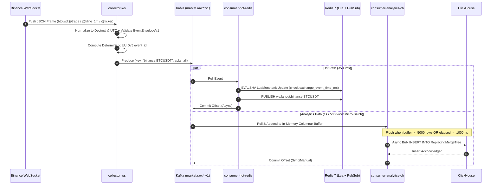

# 08 — Data Flow and Event Contracts

## 1. End-to-End Data Flows

This document specifies the exact runtime data flows, ordering rules, idempotency keys, backpressure controls, and recovery mechanisms across all platform pipelines.

See also:
- [Data Contracts Specification](../specifications/data-contracts.md)
- [Diagram 05: Data Ingestion Architecture](../diagrams/data-platform/05-data-ingestion.md)
- [Diagram 06: Event Streaming Architecture](../diagrams/data-platform/06-event-streaming.md)

---

## 2. Flow 1: Real-Time Market Ingestion & Hot State Projection

### 2.1. Ordering, Deduplication & Out-of-Order Guarantees
1. **Partition Ordering**: Because the Kafka record key is always `{provider}:{symbol}` (or `{provider}:{symbol}:{interval}`), all events for a symbol are appended to the same Kafka partition in exact collector receipt order.
2. **Out-of-Order Exchange Events / Retries**:
   - In **Redis**, the Lua script compares `incoming_exchange_event_time_ms` against `HGET key exchange_event_time_ms`. If `incoming < stored`, the write is skipped atomically.
   - In **ClickHouse**, `ReplacingMergeTree(exchange_event_time)` retains the row with the highest `exchange_event_time` for any duplicate `(provider, symbol, interval, open_time)` key, and `SELECT ... FINAL` or `argMax(..., exchange_event_time)` guarantees deterministic read results even before background merges complete.

---

## 3. Flow 2: Historical REST Backfill & WebSocket Gap Recovery

When the platform initializes a symbol or recovers from a WebSocket disconnection gap:
1. **Watermark Check**: `collector-rest` (triggered by Airflow or gap-fill event) reads `last_synced_timestamp` from PostgreSQL `ingestion_watermarks` for `(binance, BTCUSDT, klines_1m)`.
2. **Rate-Limited Paginated Fetch**: Queries `GET /api/v3/klines?symbol=BTCUSDT&interval=1m&startTime=...&limit=1000` using a token-bucket rate limiter that inspects Binance `X-MBX-USED-WEIGHT-1M` headers.
3. **Dual Routing**:
   - For short disconnection gaps ($<24\text{ hours}$), normalized `EventEnvelopeV1` events are published directly to `market.raw.klines.v1` so both ClickHouse and Bronze Lakehouse receive the missing candles through standard idempotent sinks.
   - For deep historical backfills ($90+\text{ days}$), batches are written directly to MinIO Bronze Parquet files and merged into Silver Iceberg and ClickHouse via PySpark to avoid flooding real-time Kafka topics with millions of historical archive messages.
4. **Watermark Advancement**: Only after the batch is durably committed to Kafka/MinIO does `collector-rest` advance `last_synced_timestamp` in PostgreSQL.

---

## 4. Backpressure, Consumer Lag & Replay Strategy

| Scenario | Detection Signal | Automated Backpressure / Recovery Mechanism |
|---|---|---|
| **ClickHouse Slow Insert / Merge Pressure** | `clickhouse_insert_latency_ms > 2000` or `Too many parts` error | `consumer-analytics-ch` dynamically increases batch flush window from `1s` to `5s` (up to `25,000` rows) and pauses `consumer.poll()` while retrying with exponential backoff. Kafka safely buffers incoming events on disk. |
| **Consumer Lag Breach** | `kafka_consumer_group_lag > 50,000` messages | Prometheus fires `KafkaConsumerLagHigh` alert; stateless consumer containers (`consumer-analytics-ch`) can be scaled up to the topic partition count (`6` instances). |
| **Corrupted Downstream Projection** | Great Expectations validation failure on ClickHouse or Redis | Reset consumer group offset to a historical timestamp (`kafka-consumer-groups --to-datetime`) for `<72h` recovery, or trigger the Airflow `lakehouse_to_clickhouse_rebuild` DAG for deep historical recovery from Iceberg Silver. |
| **Poison Pill / Schema Mismatch** | `pydantic.ValidationError` in Collector or Consumer | Wrapped in `DeadLetterEnvelopeV1` (preserving raw bytes, topic, partition, offset, error trace) and routed to `market.dlq.v1` so a single malformed record never blocks partition consumption. |

