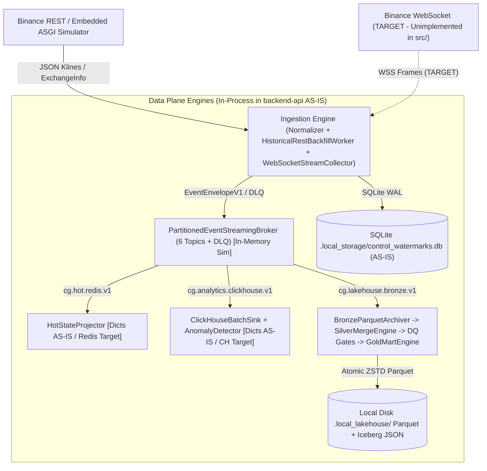

# Diagram: Data Plane C4 Container Topology

## 1. Diagram Metadata `[REQUIRED]`

| Field | Value |
|---|---|
| **Diagram ID** | `DIAG-DP-C4-001` |
| **Title & Purpose** | C4 Level 2 Container view across Data Plane ingestion, streaming, medallion processing, and storage tiers |
| **C4 Level** | Level 2 — Container |
| **Owner Role & Scope** | `data-architect / data-plane` |
| **Authoritative Source** | [data-plane-architecture.md](../data-plane-architecture.md) (`DP-ARCH-001`) |
| **Notation** | `Mermaid flowchart TB` (`C4 Model`) |
| **Version & Status** | `2.0.0 — IN_REVIEW` |

## 2. Diagram `[REQUIRED]`

## 3. Legend `[REQUIRED]`

- **Solid Arrows (`-->`)**: Active in-process execution & local persistence paths verified in `DataPlatformV01Pipeline` and `PlatformRuntimeContainer`.
- **Dashed Arrows (`-.->`)**: `TARGET` external exchange WebSocket stream not yet wired in `src/`.
