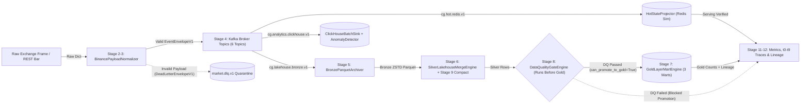

# Diagram: Streaming & Medallion 12-Stage Data Flow (DFD)

## 1. Diagram Metadata `[REQUIRED]`

| Field | Value |
|---|---|
| **Diagram ID** | `DIAG-DP-DFD-001` |
| **Title & Purpose** | Depicts normalized event streaming fan-out, DLQ quarantine, Stage 8 blocking DQ gate, and Stage 7/9 medallion sinks |
| **Owner Role & Scope** | `data-architect / data-plane` |
| **Authoritative Source** | [data-plane-architecture.md](../data-plane-architecture.md) (`DP-ARCH-001`) |
| **Notation** | `Mermaid flowchart LR` (`DFD`) |
| **Version & Status** | `2.0.0 — IN_REVIEW` |

## 2. Diagram `[REQUIRED]`

## 3. Legend `[REQUIRED]`

- **Solid Arrows (`-->`)**: Primary nominal data pipeline path (`Stage 1..12`). Note Stage 8 (`DataQualityGateEngine`) validates Silver outputs immediately prior to Stage 7 (`GoldLayerMartEngine`).
- **Dashed Arrows (`-.->`)**: Error quarantine (`market.dlq.v1`) and blocked Gold promotion gate failure path.
