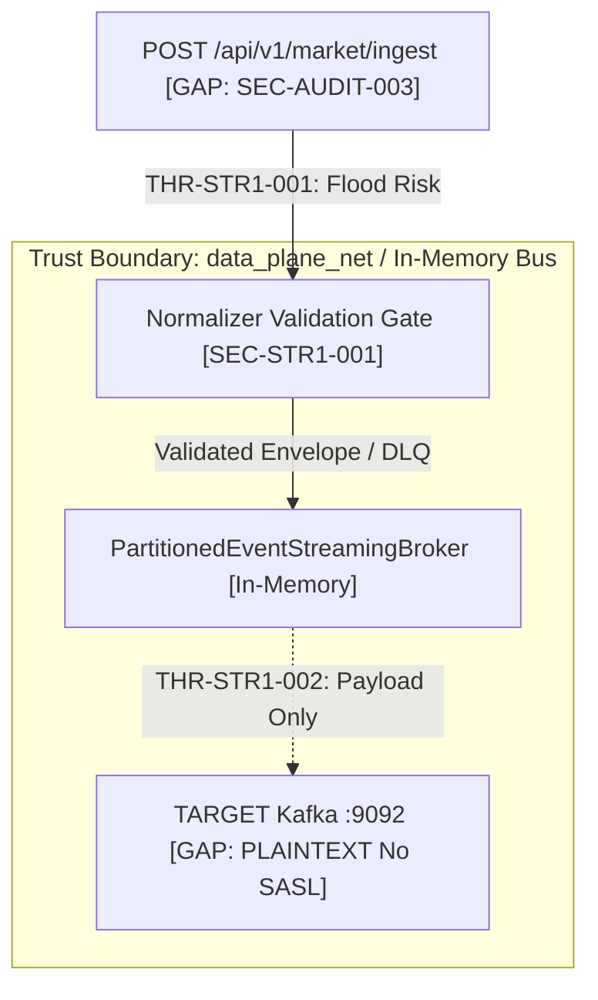

# Diagram: Kafka Event Bus Trust Boundaries

## 1. Diagram Metadata `[REQUIRED]`

| Field | Value |
|---|---|
| **Diagram ID** | `DIAG-DP-STR1-TM-001` |
| **Title & Purpose** | Shows trust boundaries around broker ingestion, in-memory topic lists, and target PLAINTEXT KRaft network |
| **Owner Role & Scope** | `security-architect / CAP-DP-STR-001` |
| **Authoritative Source** | [threat-model.md](threat-model.md) (`CAP-DP-STR1-TM-001`) |
| **Notation** | `Mermaid flowchart TB` (`Trust Boundary DFD`) |
| **Version & Status** | `2.0.0 — IN_REVIEW` |

## 2. Diagram `[REQUIRED]`

## 3. Legend `[REQUIRED]`

- **Dashed Arrow (`-.->`)**: Uninstantiated Confluent producer bridge (`_confluent_adapter`).
