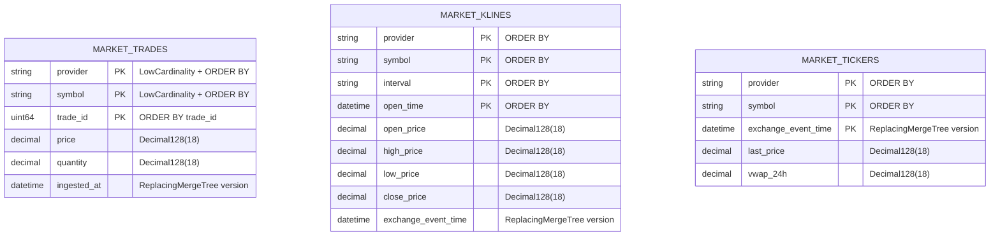

# Diagram: ClickHouse Analytical Schema & Redis Key Entities

## 1. Diagram Metadata `[REQUIRED]`

| Field | Value |
|---|---|
| **Diagram ID** | `DIAG-DP-STR2-ERD-001` |
| **Title & Purpose** | Physical ClickHouse tables (`market_trades`, `market_klines`, `market_tickers`) and logical Redis hot keys |
| **Model Level** | Physical (`TARGET` ClickHouse DDL; simulated in-memory `AS-IS`) |
| **Owner Role & Scope** | `database-architect / CAP-DP-STR-002` |
| **Authoritative Source** | [database-design.md](database-design.md) (`CAP-DP-STR2-DB-001`) |
| **Notation** | `Mermaid erDiagram` (`Crow's Foot`) |
| **Version & Status** | `2.0.0 — IN_REVIEW` |

## 2. Diagram `[REQUIRED]`

## 3. Legend `[REQUIRED]`

- **Analytical Columns**: Columnar ClickHouse `ReplacingMergeTree` keys (`ORDER BY` tuple shown as composite sorting keys, not relational enforced constraints).
