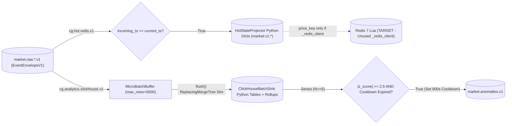

# Diagram: Streaming Projections Data Flow

## 1. Diagram Metadata `[REQUIRED]`

| Field | Value |
|---|---|
| **Diagram ID** | `DIAG-DP-STR2-DFD-001` |
| **Title & Purpose** | Shows streaming fan-out into HotStateProjector, ClickHouseBatchSink, and StatisticalAnomalyDetector |
| **Owner Role & Scope** | `data-architect / CAP-DP-STR-002` |
| **Authoritative Source** | [component-design.md](component-design.md) (`CAP-DP-STR2-COMP-001`) |
| **Notation** | `Mermaid flowchart LR` (`DFD`) |
| **Version & Status** | `2.0.0 — IN_REVIEW` |

## 2. Diagram `[REQUIRED]`

## 3. Legend `[REQUIRED]`

- **Solid Arrows (`-->`)**: Active in-process simulation data flow.
- **Dashed Arrows (`-.->`)**: Optional un-wired live Redis Lua bridge.
