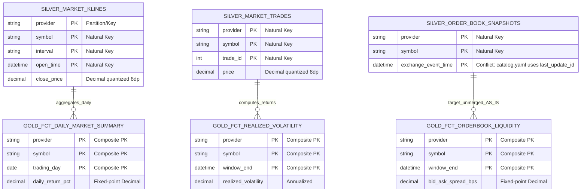

# Diagram: Silver & Gold Medallion Entity Relationships

## 1. Diagram Metadata `[REQUIRED]`

| Field | Value |
|---|---|
| **Diagram ID** | `DIAG-DP-LAK-ERD-001` |
| **Title & Purpose** | Logical & physical key relationships across Silver market tables and Gold fact marts |
| **Model Level** | Logical / Parquet Physical (`AS-IS` Local Parquet) |
| **Owner Role & Scope** | `database-architect / CAP-DP-LAK-001` |
| **Authoritative Source** | [data-model.md](data-model.md) (`CAP-DP-LAK-MOD-001`) |
| **Notation** | `Mermaid erDiagram` (`Crow's Foot`) |
| **Version & Status** | `2.0.0 — IN_REVIEW` |

## 2. Diagram `[REQUIRED]`

## 3. Legend `[REQUIRED]`

- `||--o{`: Derived analytical lineage from Silver source dataset to Gold fact mart (`silver.order_book_snapshots` merge is `NOT_IMPLEMENTED` in `merge_engine.py`).
