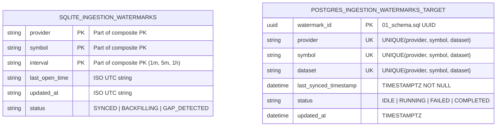

# Diagram: Ingestion Watermark Physical Schemas

## 1. Diagram Metadata `[REQUIRED]`

| Field | Value |
|---|---|
| **Diagram ID** | `DIAG-DP-ING-ERD-001` |
| **Title & Purpose** | Side-by-side schema diagram showing AS-IS SQLite `ingestion_watermarks` and TARGET Postgres `ingestion_watermarks` |
| **Model Level** | Physical (`AS-IS` + `TARGET` Comparison) |
| **Owner Role & Scope** | `database-architect / CAP-DP-ING-001` |
| **Authoritative Source** | [database-design.md](database-design.md) (`CAP-DP-ING-DB-001`) |
| **Notation** | `Mermaid erDiagram` (`Crow's Foot`) |
| **Version & Status** | `2.0.0 — IN_REVIEW` |

## 2. Diagram `[REQUIRED]`

## 3. Legend `[REQUIRED]`

- `SQLITE_INGESTION_WATERMARKS`: Active `AS-IS` store initialized in `src/ingestion/infrastructure/watermark_store.py`.
- `POSTGRES_INGESTION_WATERMARKS_TARGET`: Unwired `TARGET` DDL in `deploy/postgres/init/01_schema.sql:30-39` with mismatched `dataset` key and status constraint.
