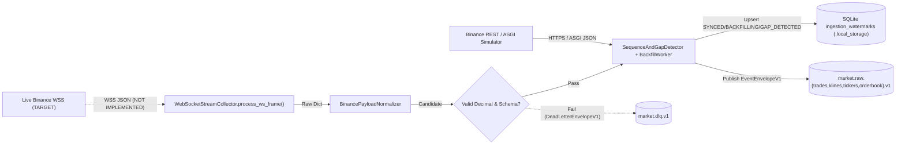

# Diagram: Ingestion Normalization, Watermark & DLQ Data Flow

## 1. Diagram Metadata `[REQUIRED]`

| Field | Value |
|---|---|
| **Diagram ID** | `DIAG-DP-ING-DFD-001` |
| **Title & Purpose** | Ingestion data flow from Binance REST / injected WS frames into EventEnvelopeV1, SQLite watermarks, and DLQ |
| **Owner Role & Scope** | `data-architect / CAP-DP-ING-001` |
| **Authoritative Source** | [component-design.md](component-design.md) (`CAP-DP-ING-COMP-001`) |
| **Notation** | `Mermaid flowchart LR` (`DFD`) |
| **Version & Status** | `2.0.0 — IN_REVIEW` |

## 2. Diagram `[REQUIRED]`

## 3. Legend `[REQUIRED]`

- **Solid Arrows (`-->`)**: Active Python data flow executed by `ws_service.py` / `backfill_service.py`.
- **Dashed Arrows (`-.->`)**: `TARGET` unimplemented WSS socket loop and DLQ quarantine path.
