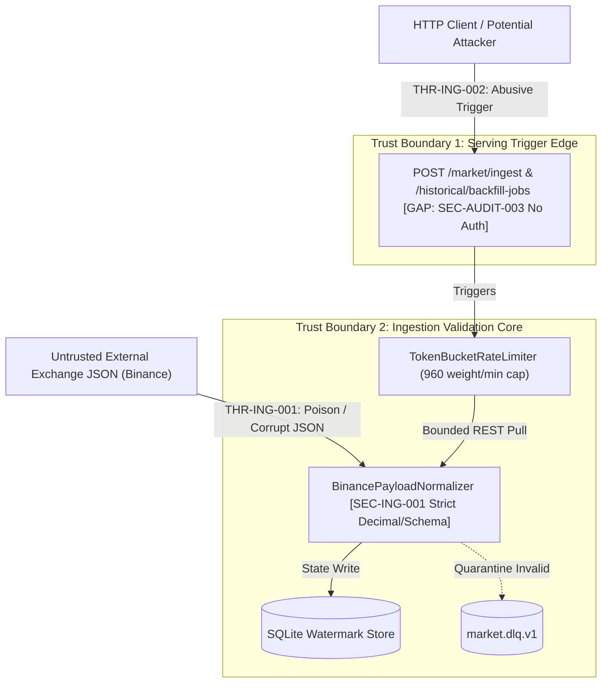

# Diagram: Exchange Ingestion Threat Model & Trust Boundaries

## 1. Diagram Metadata `[REQUIRED]`

| Field | Value |
|---|---|
| **Diagram ID** | `DIAG-DP-ING-TM-001` |
| **Title & Purpose** | Shows trust boundaries across external Binance feeds, HTTP API triggers, normalizer validation, and SQLite/Kafka stores |
| **Owner Role & Scope** | `security-architect / CAP-DP-ING-001` |
| **Authoritative Source** | [threat-model.md](threat-model.md) (`CAP-DP-ING-TM-001`) |
| **Notation** | `Mermaid flowchart TB` (`Trust Boundary DFD`) |
| **Version & Status** | `2.0.0 — IN_REVIEW` |

## 2. Diagram `[REQUIRED]`

## 3. Legend `[REQUIRED]`

- **Subgraphs**: Explicit privilege/validation trust boundaries.
- **`[GAP: ...]`**: Confirmed missing authentication control (`SEC-AUDIT-003`); never treated as mitigated.
