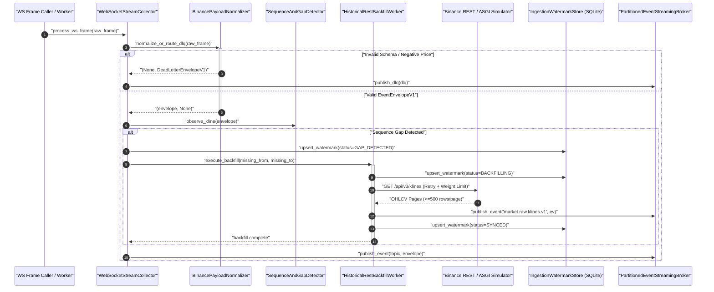

# Diagram: Ingestion Sequence, Gap Detection & Backfill Recovery

## 1. Diagram Metadata `[REQUIRED]`

| Field | Value |
|---|---|
| **Diagram ID** | `DIAG-DP-ING-SEQ-001` |
| **Title & Purpose** | Chronological flow across normalizer, gap detector, REST pagination, watermark SQLite store, and Kafka broker |
| **Owner Role & Scope** | `data-architect / CAP-DP-ING-001` |
| **Authoritative Source** | [use-case-ingestion-and-gap-heal.md](../use-cases/use-case-ingestion-and-gap-heal.md) (`CAP-DP-ING-UC-001`) |
| **Notation** | `Mermaid sequenceDiagram` (`UML 2.5.1`) |
| **Version & Status** | `2.0.0 — IN_REVIEW` |

## 2. Diagram `[REQUIRED]`

## 3. Legend `[REQUIRED]`

- **Solid Arrow (`->>`)**: Synchronous/async Python call or HTTP request.
- **Dashed Arrow (`-->>`)**: Return value or response payload.
- **`alt` / `else`**: Error quarantine (`market.dlq.v1`) and automatic gap backfill paths.
