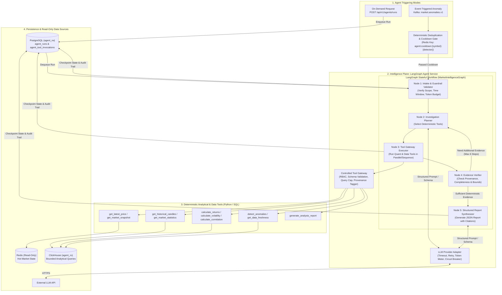

# Diagram 12: Agentic Intelligence Architecture

## Architectural Explanation

The **Agentic Intelligence Architecture** illustrates how the **Intelligence Plane** operates as an isolated service (`agent-worker` + `agent_api` module) powered by **LangGraph**:
- **Dual Trigger Entrypoints**:
  1. **On-Demand Analysis**: Triggered via `POST /api/v1/agents/runs` by an authenticated analyst.
  2. **Event-Triggered Investigation**: Triggered when the deterministic `StatisticalAnomalyDetector` publishes a breach event to `market.anomalies.v1` and passes the deduplication cooldown filter (e.g., 15-minute window per symbol/detector).
- **Stateful LangGraph Orchestrator (`MarketIntelligenceGraph`)**:
  - Executes explicit state nodes (`Intake & Scope Validation` $\rightarrow$ `Tool Planning` $\rightarrow$ `Controlled Tool Gateway Execution` $\rightarrow$ `Evidence Verification` $\rightarrow$ `Structured Report Synthesis`).
  - Persists state checkpoints, tool invocation trails, token usage, and final reports to **PostgreSQL**.
- **Strict Isolation**: The Intelligence Plane accesses market data exclusively in **read-only** mode through the **Deterministic Tool Gateway** and can fail completely without affecting the Data Plane.

