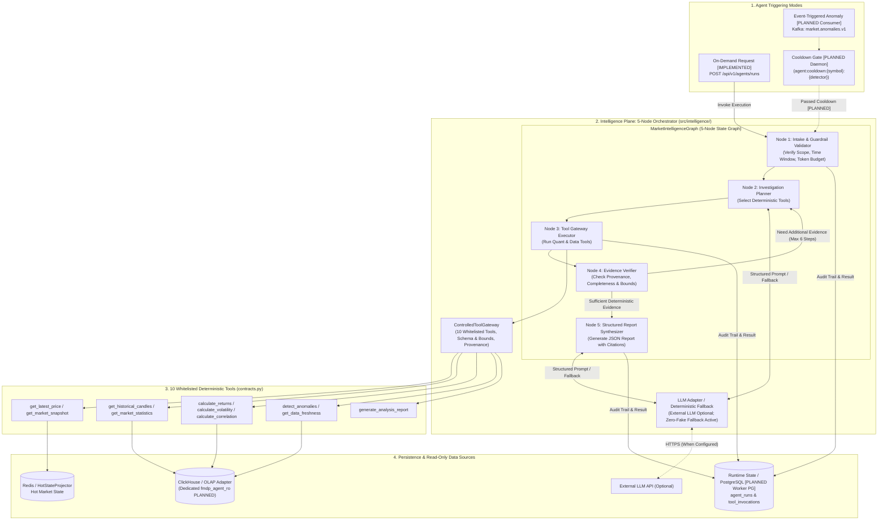

# Diagram 12: Agentic Intelligence Architecture (`DIAG-C4-012`)

| Diagram Metadata | Value |
|---|---|
| **Diagram ID** | `DIAG-C4-012` (legacy `DOCS-002` alias: `DIAG-COMP-012`) |
| **Title** | Agentic Intelligence Architecture (5-Node LangGraph + 10-Tool Gateway) |
| **Diagram Category** | `docs/diagrams/agent/` |
| **Notation / Mermaid Type** | `Mermaid (flowchart TB)` |
| **Status** | `IMPLEMENTED` / `PARTIALLY_IMPLEMENTED` (5-node graph & 10-tool gateway implemented in `src/intelligence/`; standalone `agent-worker` daemon loop `PROP-APP-002`, Kafka anomaly consumer & `fmdp_agent_ro` SQL user `[PLANNED]`) |
| **Version** | `1.1.0` |
| **Authoritative Document Reference** | `docs/architecture/06-agentic-intelligence-architecture.md` |
| **Canonical Model Reference** | `models/architecture/components.yaml`, `models/interaction/interactions.yaml` |
| **Related Artifact IDs** | `COMP-005`, `COMP-019`, `API-008`, `API-009`, `PROP-APP-002` |

## Architectural Explanation

The **Agentic Intelligence Architecture** illustrates how the **Intelligence Plane** (`src/intelligence/`, plus `agent-worker` container definition) executes **MarketIntelligenceGraph**:
- **Trigger Entrypoints**:
  1. **On-Demand Analysis (`[IMPLEMENTED]`)**: Triggered via `POST /api/v1/agents/runs` (`API-008`) executing `MarketIntelligenceGraph` + `ControlledToolGateway`.
  2. **Event-Triggered Investigation (`[PLANNED]` Daemon Consumer)**: Target integration consuming `market.anomalies.v1` through a deduplication cooldown filter.
- **Stateful 5-Node Orchestrator (`MarketIntelligenceGraph`)**:
  - `Intake & Guardrail Validator` $\rightarrow$ `Investigation Planner` $\rightarrow$ `Tool Gateway Executor` $\rightarrow$ `Evidence Verifier` $\rightarrow$ `Structured Report Synthesizer`.
  - Standalone `agent-worker` CLI loop (`src/intelligence/main.py`) is currently a stub (`PROP-APP-002`); active runs store evidence trails in `PlatformRuntimeContainer.agent_runs` (with PostgreSQL persistent worker checkpointing & `fmdp_agent_ro` ClickHouse SQL user `[PLANNED]`).

