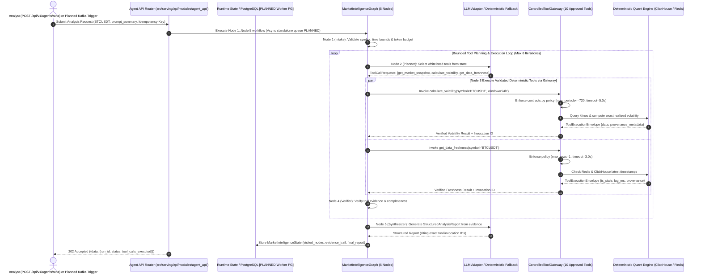

# Diagram 13: Agent Workflow Sequence Diagram (`DIAG-SEQ-013`)

| Diagram Metadata | Value |
|---|---|
| **Diagram ID** | `DIAG-SEQ-013` |
| **Title** | Agent Workflow Sequence Diagram |
| **Diagram Category** | `docs/diagrams/agent/` |
| **Notation / Mermaid Type** | `Mermaid (sequenceDiagram)` |
| **Status** | `IMPLEMENTED` / `PARTIALLY_IMPLEMENTED` (in-process 5-node flow & 10 tools active; async Kafka trigger & standalone PG queue worker `[PLANNED]`) |
| **Version** | `1.1.0` |
| **Authoritative Document Reference** | `docs/architecture/06-agentic-intelligence-architecture.md` |
| **Canonical Model Reference** | `models/interaction/interactions.yaml`, `models/process/processes.yaml` |
| **Related Artifact IDs** | `API-008`, `API-009`, `COMP-005`, `TC-005` |

## Architectural Explanation

The **Agent Workflow Sequence Diagram** traces the execution of an Agent analysis run through the 5-node `MarketIntelligenceGraph` and 10-tool `ControlledToolGateway` (`contracts.py`), highlighting how **every quantitative figure is computed deterministically** by validated Python/OLAP tools (with per-tool timeouts `1.5s`–`8.0s` and period/row limits) while external LLM synthesis and standalone PostgreSQL worker queue consumption are optional / `[PLANNED]` enhancements.

