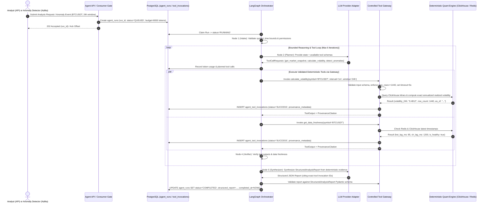

# Diagram 13: Agent Workflow Sequence Diagram

## Architectural Explanation

The **Agent Workflow Sequence Diagram** traces the end-to-end execution of an Agent analysis run across both triggering modes, highlighting how **every quantitative figure is computed deterministically** by the Tool Gateway rather than by LLM arithmetic, and how every step is audited in PostgreSQL.

