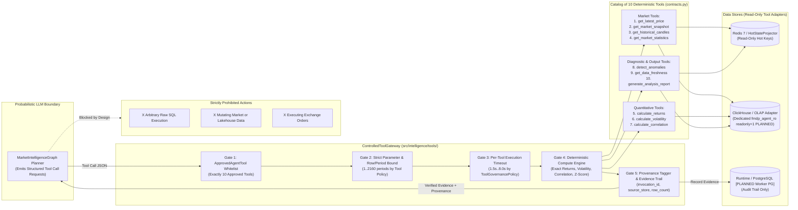

# Diagram 14: Agent Tool Access & Security Guardrail Diagram (`DIAG-SEC-014`)

| Diagram Metadata | Value |
|---|---|
| **Diagram ID** | `DIAG-SEC-014` (legacy `DOCS-002` alias: `DIAG-COMP-014`) |
| **Title** | Agent Tool Access & Security Guardrail Architecture |
| **Diagram Category** | `docs/diagrams/agent/` |
| **Notation / Mermaid Type** | `Mermaid (flowchart LR)` |
| **Status** | `IMPLEMENTED` / `PARTIALLY_IMPLEMENTED` (10-tool `ControlledToolGateway` & bounds active in `src/intelligence/tools/`; ClickHouse dedicated `fmdp_agent_ro` SQL user `[PLANNED]`) |
| **Version** | `1.1.0` |
| **Authoritative Document Reference** | `docs/architecture/06-agentic-intelligence-architecture.md`, `docs/architecture/10-security-and-governance.md` |
| **Canonical Model Reference** | `models/architecture/components.yaml`, `models/security/threat-model.yaml` |
| **Related Artifact IDs** | `THR-005`, `CTRL-005`, `COMP-005`, `TC-005` |

## Architectural Explanation

The **Agent Tool Access Diagram** illustrates the security boundary between the reasoning layer and platform data stores (`src/intelligence/tools/contracts.py` & `gateway.py`):
1. **Tool Whitelist & Permission Mapping**: Confirms the tool is in `ApprovedAgentTool` (the **10** approved read-only tools) and checks `required_permission` (`market:read`, `historical:read`, `analytics:read`).
2. **Strict Bound Validator**: Rejects SQL fragments, invalid symbols, or row/period windows exceeding `max_rows_or_periods` (`1`, `168`, `500`, `720`, or `2160` per tool policy).
3. **Per-Tool Timeout Guard**: Enforces `timeout_seconds` per `APPROVED_TOOL_POLICIES` (`1.5s` to `8.0s`).
4. **Deterministic Python/OLAP Execution**: Computes returns, volatility, correlations, and Z-scores using exact deterministic math over read-only adapters (note: dedicated ClickHouse `fmdp_agent_ro` database user in Compose init is `[PLANNED]`).
5. **Provenance & Audit Stamp**: Attaches `invocation_id`, `source_store`, `symbol`, and `row_count` in every `ToolExecutionEnvelope`.

