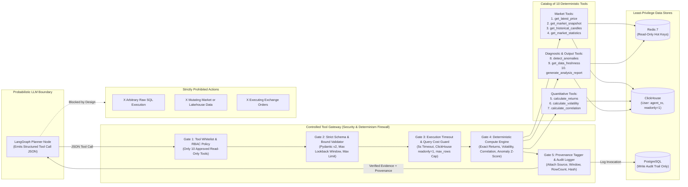

# Diagram 14: Agent Tool Access & Security Guardrail Diagram

## Architectural Explanation

The **Agent Tool Access Diagram** illustrates the security boundary between the non-deterministic LLM reasoning engine and the platform's data stores. The LLM has **zero network or credential access** to Redis, ClickHouse, PostgreSQL, or MinIO. Instead, every tool request passes through five mandatory enforcement gates inside the **Controlled Tool Gateway**:
1. **Tool Whitelist & RBAC Check**: Confirms the tool is in the 10 approved read-only tools and permitted for the caller's role.
2. **Pydantic Strict Input Validation**: Rejects any SQL fragments, invalid symbols, or time windows exceeding maximum lookback bounds.
3. **Resource & Timeout Sandbox**: Wraps execution in `asyncio.wait_for(timeout=5.0)` and binds ClickHouse `max_execution_time=5`, `max_rows_to_read=500000`, `readonly=1`.
4. **Deterministic Python/SQL Execution**: Computes returns, volatility, correlations, and Z-scores using exact decimal/NumPy routines over ClickHouse/Redis read-only adapters.
5. **Provenance & Audit Stamp**: Attaches `invocation_id`, `source_store`, `time_range`, `row_count`, and `sha256_evidence_hash` before returning the result to the LangGraph state.

