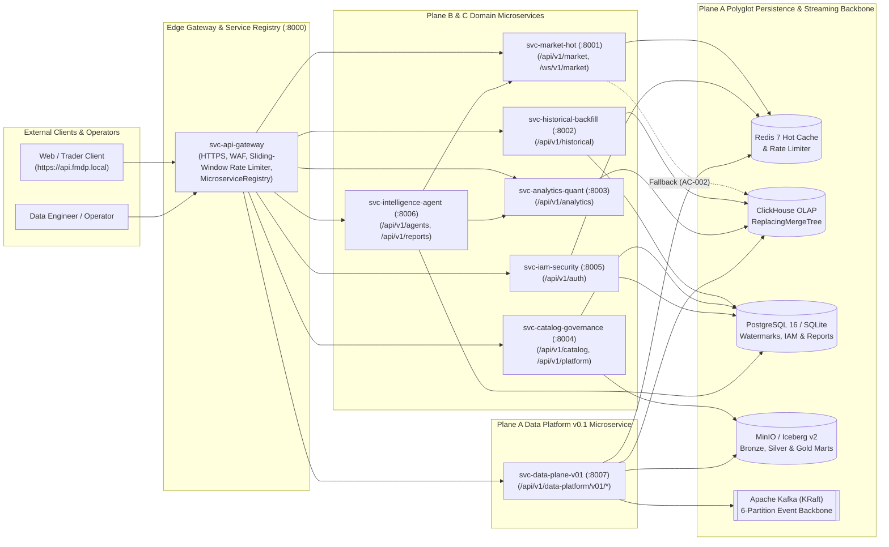

# Diagram 17 — Domain Microservices Decomposition Topology (`DIAG-C4-017`)

## 1. Purpose

Depicts the decomposition of the Financial Market Data Platform on branch `arch/microservices` (`ADR-007`) into 8 independently deployable domain microservices behind the Unified HTTPS API Gateway (`svc-api-gateway`).

---

## 2. Mermaid Architecture Flowchart (`DIAG-C4-017`)

