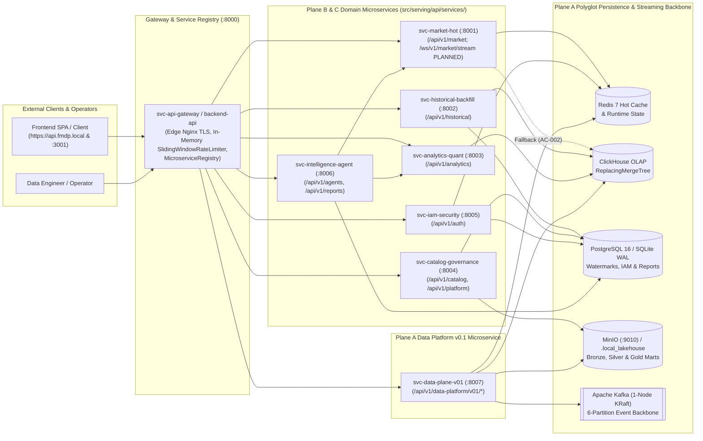

# Diagram 17 — Domain Microservices Decomposition Topology (`DIAG-C4-017`)

| Diagram Metadata | Value |
|---|---|
| **Diagram ID** | `DIAG-C4-017` |
| **Title** | Domain Microservices Decomposition Topology |
| **Diagram Category** | `docs/diagrams/architecture/` |
| **Notation / Mermaid Type** | `Mermaid (flowchart LR)` |
| **Status** | `IMPLEMENTED` (`docker-compose.yml --profile microservices` + `src/serving/api/services/*.py` + `gateway/service.py`) |
| **Version** | `1.1.0` |
| **Authoritative Document Reference** | `docs/architecture/14-data-platform-v01-and-microservices-architecture.md`, `docs/architecture/adr/ADR-007-microservices-and-data-platform-v01.md` |
| **Canonical Model Reference** | `models/architecture/components.yaml`, `models/deployment/deployment.yaml` |
| **Related Artifact IDs** | `ADR-007`, `DEP-006`, `COMP-015`..`COMP-020`, `API-003 (PLANNED)` |

## 1. Purpose

Depicts the decomposition of the Financial Market Data Platform (`ADR-007`) into 7 domain ASGI wrappers (`src/serving/api/services/*.py`, ports `8001`..`8007`) coordinated behind the Unified API Gateway (`svc-api-gateway`, port `8000`) and Nginx `edge-gateway`. Note: `WS /ws/v1/market/stream` (`API-003`) is `[PLANNED]`; real-time Observatory telemetry (`API-055`/`API-056`) is served on `backend-api` via `gateway/observability.py`.

---

## 2. Mermaid Architecture Flowchart (`DIAG-C4-017`)

