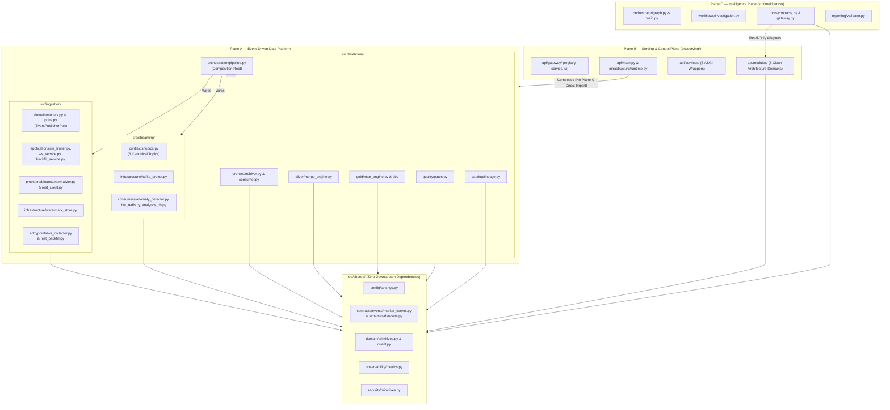

# Diagram 19 — Event-Driven Modular Data Platform Layers & Dependency Boundaries (`DIAG-C4-019`)

| Diagram Metadata | Value |
|---|---|
| **Diagram ID** | `DIAG-C4-019` |
| **Title** | Event-Driven Modular Data Platform Package & Dependency Boundaries |
| **Diagram Category** | `docs/diagrams/architecture/` |
| **Notation / Mermaid Type** | `Mermaid (flowchart TB)` |
| **Status** | `APPROVED` (`BASELINED`) |
| **Version** | `1.0.0` |
| **Authoritative Document Reference** | `docs/architecture/adr/ADR-008-event-driven-modular-data-platform.md` |
| **Canonical Model Reference** | `models/architecture/architecture.yaml` |
| **Related Artifact IDs** | `ADR-008`, `MODEL-ARCH-001`, `MODEL-ARCH-002`, `TC-006` |

---

## 1. Architectural / Behavioral Explanation

Illustrates the restructured **Event-Driven Modular Data Platform** (`ARCH-001` / `ADR-008`) separating `src/shared/`, `src/ingestion/`, `src/streaming/`, `src/lakehouse/`, `src/serving/`, and `src/intelligence/`. Cross-subsystem AST dependency rules enforced by `tests/architecture/test_clean_architecture_boundaries.py` (`TC-006`) guarantee:
- `src/shared/` holds only genuinely shared contracts, config, domain/quant math, observability, and security primitives with zero dependency on downstream layers.
- `src/ingestion/` depends strictly on `EventPublisherPort` (`src/ingestion/domain/ports.py`) and never imports `src/streaming/`, `src/lakehouse/`, `src/serving/`, or `src/intelligence/`.
- `src/streaming/` owns Kafka broker/topics/consumers and never imports `src/ingestion/`, `src/lakehouse/`, `src/serving/`, or `src/intelligence/`.
- `src/lakehouse/` isolates `bronze`, `silver`, `gold`, `quality`, and `catalog`, coordinated at runtime solely through `src/lakehouse/orchestration/pipeline.py` (composition root).
- `src/serving/api/` preserves the 8-module Clean Architecture Modular Monolith alongside thin ASGI wrappers (`services/`) and Edge Gateway (`gateway/`), with zero dependency on `src/intelligence/`.

---

## 2. Mermaid Diagram View

