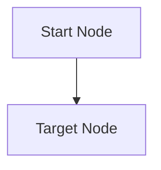

# Diagram Template: Product & Subsystem Architecture Views (`[TEMPLATE]`)

| Diagram Metadata | Value |
|---|---|
| **Diagram ID** | `DIAG-C4-[NNN]` |
| **Title** | `[TO BE COMPLETED]` |
| **Diagram Category** | `docs/diagrams/architecture/` |
| **Notation / Mermaid Type** | `Mermaid (flowchart TB)` |
| **Status** | `TEMPLATE` (`[PROPOSED — NOT APPROVED]`) |
| **Version** | `0.1.0` |
| **Authoritative Document Reference** | `docs/product/06-architecture/` |
| **Canonical Model Reference** | `models/architecture/architecture.yaml` |
| **Related Artifact IDs** | `[TO BE COMPLETED]` |

---

## 1. Architectural / Behavioral Explanation

`[TO BE COMPLETED — Explain the exact components, flows, alternative/exception paths, and boundaries shown below.]`

---

## 2. Mermaid Diagram View

