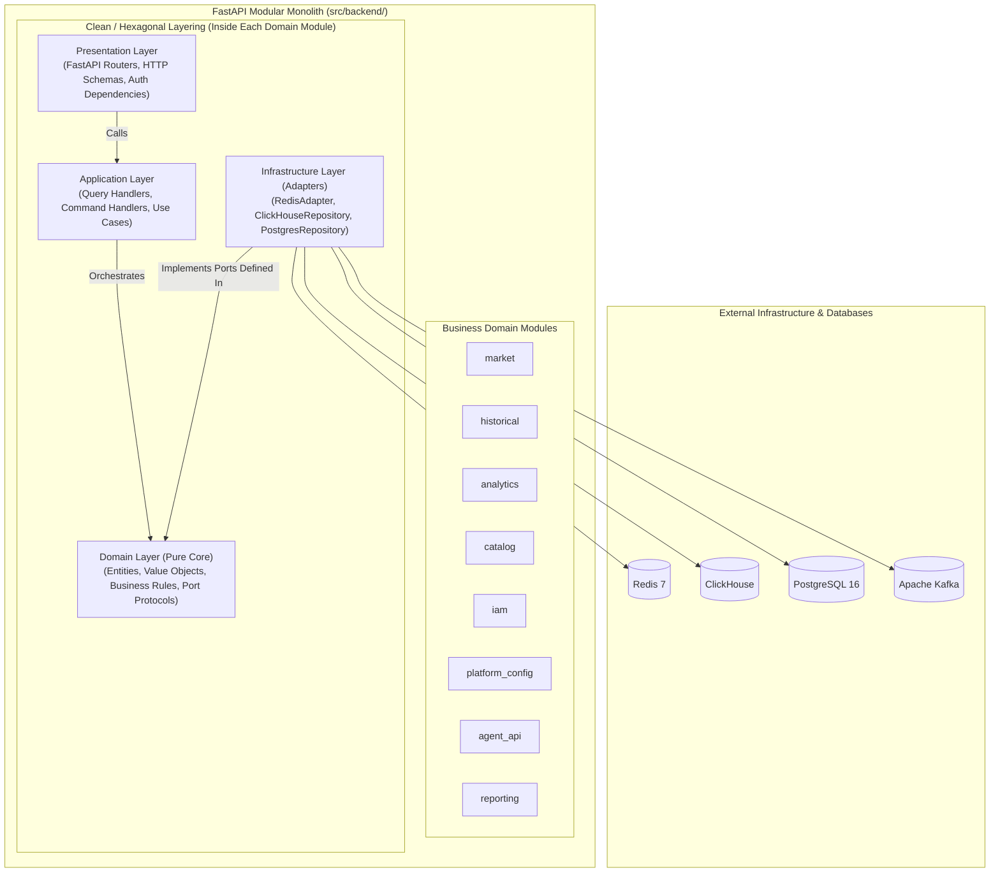

# Diagram 08: Backend Module & Clean/Hexagonal Architecture

## Architectural Explanation

The **Backend Module Architecture** demonstrates how the FastAPI Modular Monolith (`backend-api`) is organized into eight cohesive business domain modules (`market`, `historical`, `analytics`, `catalog`, `iam`, `platform_config`, `agent_api`, `reporting`) and how each module internally adheres to **Clean / Hexagonal Architecture**:
- **Presentation Layer**: FastAPI Routers, HTTP Request/Response Pydantic schemas, Authentication & Rate-Limit dependencies.
- **Application Layer**: Use Cases, Query Handlers, Command Handlers, and DTOs.
- **Domain Layer (Core)**: Pure Python Entities, Value Objects (`Symbol`, `Price`, `TimeRange`), Domain Services, and Repository/Adapter Port Interfaces (`Protocol`). Has **zero outward dependencies**.
- **Infrastructure Layer**: Concrete Adapters implementing Domain Ports (`RedisMarketHotAdapter`, `ClickHouseHistoricalAdapter`, `PostgresControlAdapter`, `KafkaEventPublisher`).

