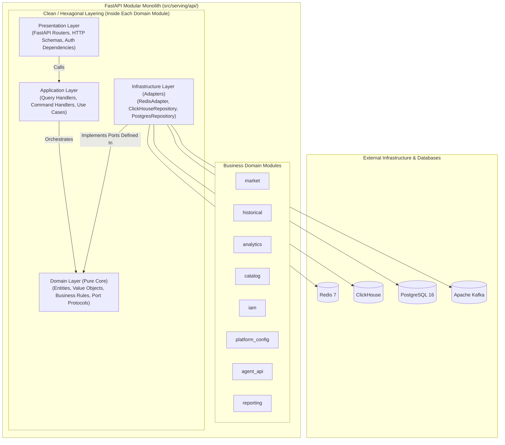

# Diagram 08: Backend Module & Clean/Hexagonal Architecture (`DIAG-COMP-008`)

| Diagram Metadata | Value |
|---|---|
| **Diagram ID** | `DIAG-COMP-008` |
| **Title** | Backend Module & Clean/Hexagonal Architecture |
| **Diagram Category** | `docs/diagrams/backend/` |
| **Notation / Mermaid Type** | `Mermaid (flowchart TB)` |
| **Status** | `IMPLEMENTED` |
| **Version** | `1.1.0` |
| **Authoritative Document Reference** | `docs/architecture/05-backend-architecture.md` |
| **Canonical Model Reference** | `models/architecture/components.yaml` |
| **Related Artifact IDs** | `COMP-008`..`COMP-020`, `ADR-007`, `ADR-008` |

## Architectural Explanation

The **Backend Module Architecture** demonstrates how the FastAPI Modular Monolith (`backend-api` in `src/serving/api/main.py`) is organized into **8 cohesive business domain modules** (`market`, `historical`, `analytics`, `catalog`, `iam`, `platform_config`, `agent_api`, `reporting`) alongside `gateway/` (`registry`, `service`, `observability`) and `services/` (7 standalone ASGI wrappers), where each module adheres to **Clean / Hexagonal Architecture**:
- **Presentation Layer**: FastAPI Routers and HTTP Request/Response schemas.
- **Application Layer**: Query Handlers, Command Handlers, Use Cases, and DTOs.
- **Domain Layer (Core)**: Pure Python Entities, Value Objects, Business Rules, and Port Protocols (`Protocol`) with zero outward dependencies.
- **Infrastructure Layer**: Concrete adapters bound through `PlatformRuntimeContainer` (with in-process runtime / SQLite WAL fallback and Docker Compose backing stores).

