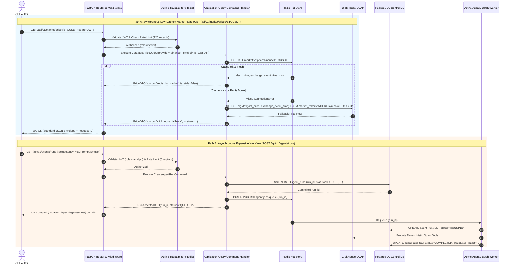

# Diagram 09: Backend Request Lifecycle (Synchronous Hot/OLAP Read vs. Asynchronous Job)

## Architectural Explanation

The **Backend Request Lifecycle Sequence Diagram** contrasts two fundamental execution paths in the FastAPI backend:
1. **Path A — Low-Latency Synchronous Read (`GET /api/v1/market/prices/BTCUSDT`)**:
   - Passes through Correlation ID middleware, JWT/API-Key authentication, and Redis sliding-window rate limiting.
   - `MarketQueryHandler` queries `RedisMarketHotAdapter` ($<5\text{ ms}$).
   - If Redis misses or is unreachable, transparently falls back to `ClickHouseMarketAdapter` with circuit-breaker protection, computes staleness metadata (`is_stale`), and returns `200 OK`.
2. **Path B — Long-Running Asynchronous Job (`POST /api/v1/agents/runs` or Heavy Backfill)**:
   - Validates request schema and `Idempotency-Key`, persists a `QUEUED` run record in PostgreSQL, notifies the background worker queue, and immediately returns `202 Accepted` with `run_id` and status polling / SSE URLs so the FastAPI event loop is never blocked.

