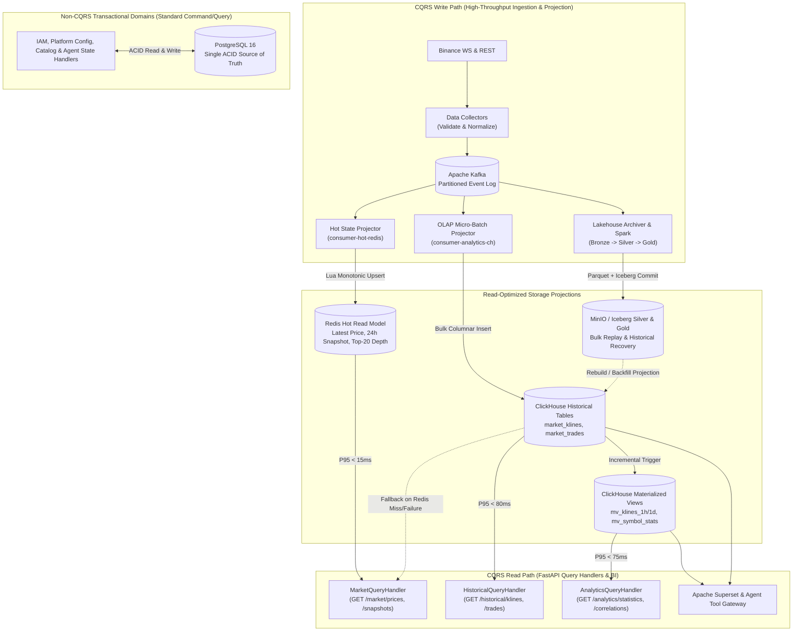

# Diagram 10: Selective CQRS Read/Write Architecture

## Architectural Explanation

The **CQRS Read/Write Architecture Diagram** illustrates how **Selective CQRS** is applied strictly where write and read workloads diverge:
- **High-Volume Market & Analytical Domains (CQRS Enabled)**:
  - **Write Side (Ingestion & Projection Pipeline)**: External exchange streams and REST backfills flow through Collectors $\rightarrow$ Kafka $\rightarrow$ specialized projectors (`consumer-hot-redis`, `consumer-analytics-ch`, `consumer-lakehouse-bronze`).
  - **Read Side (Query Models)**: FastAPI Query Handlers read exclusively from read-optimized projections:
    - Redis Hashes/JSON for sub-15ms latest price, snapshot, and order book reads.
    - ClickHouse `ReplacingMergeTree` tables for historical candles and trades.
    - ClickHouse `AggregatingMergeTree` Materialized Views for pre-aggregated statistics and Superset dashboards.
- **Control & Transactional Domains (Standard CRUD — No CQRS)**:
  - Users, RBAC, Platform Configuration, and Agent Run Metadata use standard transactional PostgreSQL repositories for both commands and queries, avoiding unnecessary projection synchronization complexity.

