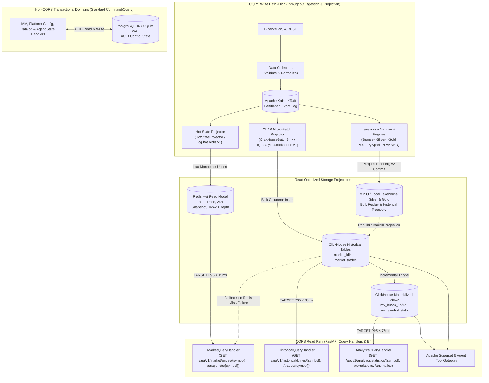

# Diagram 10: Selective CQRS Read/Write Architecture (`DIAG-COMP-010`)

| Diagram Metadata | Value |
|---|---|
| **Diagram ID** | `DIAG-COMP-010` |
| **Title** | Selective CQRS Read/Write Architecture |
| **Diagram Category** | `docs/diagrams/backend/` |
| **Notation / Mermaid Type** | `Mermaid (flowchart TB)` |
| **Status** | `IMPLEMENTED` (with `[TARGET SLO]` latency notes and `[PLANNED]` PySpark Phase 2 batch) |
| **Version** | `1.1.0` |
| **Authoritative Document Reference** | `docs/architecture/05-backend-architecture.md` |
| **Canonical Model Reference** | `models/architecture/components.yaml`, `models/api/api.yaml` |
| **Related Artifact IDs** | `ADR-002`, `API-001`..`API-007`, `AC-002` |

## Architectural Explanation

The **CQRS Read/Write Architecture Diagram** illustrates how **Selective CQRS** is applied strictly where write and read workloads diverge:
- **High-Volume Market & Analytical Domains (CQRS Enabled)**:
  - **Write Side (Ingestion & Projection Pipeline)**: External exchange streams and REST backfills flow through Collectors $\rightarrow$ Kafka $\rightarrow$ specialized projectors (`HotStateProjector`, `ClickHouseBatchSink`, `BronzeParquetArchiver` + `SilverLakehouseMergeEngine` / `GoldMartEngine`).
  - **Read Side (Query Models)**: FastAPI Query Handlers read from read-optimized projections (`/api/v1/market/prices/{symbol}`, `/snapshots/{symbol}`, `/orderbook/{symbol}` from Redis with ClickHouse fallback; `/api/v1/historical/klines/{symbol}`, `/trades/{symbol}` and `/api/v1/analytics/statistics/{symbol}`, `/correlations`, `/anomalies` from ClickHouse / Analytical projections).
- **Control & Transactional Domains (Standard CRUD — No CQRS)**:
  - IAM, Platform Configuration, Watermarks, and Agent Run Metadata use SQLite WAL / PostgreSQL transactional persistence without CQRS projection overhead.

