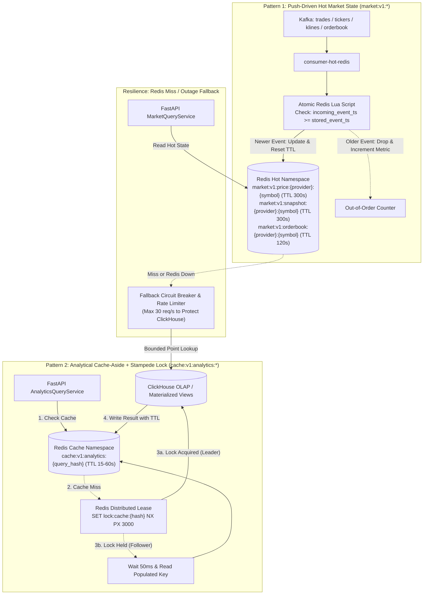

# Diagram 11: Cache Architecture (Hot Push, Analytical Cache-Aside & Stampede Protection)

## Architectural Explanation

The **Cache Architecture Diagram** defines the two distinct caching patterns implemented in Redis and their failure/invalidation guarantees:

1. **Pattern 1 — Push-Driven Hot State (`market:v1:*`)**:
   - Populated continuously by `consumer-hot-redis` from Kafka.
   - Uses an **Atomic Lua Script** that checks `if tonumber(ARGV[1]) >= tonumber(current_event_time) then HSET ... EXPIRE 300 end` to guarantee out-of-order Kafka retries never overwrite newer market prices.
   - On cache miss or Redis outage, `MarketQueryService` falls back to ClickHouse via a rate-limited circuit breaker.
2. **Pattern 2 — Pull-Driven Analytical Cache-Aside with Stampede Lock (`cache:v1:analytics:*`)**:
   - Used only for repeatable expensive analytical aggregations (e.g., 24h rolling volatility summary, multi-symbol correlation matrix) with short TTLs ($15\text{ s} - 60\text{ s}$).
   - **Stampede Protection**: On a cache miss, the first request acquires a short distributed lease (`SET lock:cache:{hash} 1 NX PX 3000`), queries ClickHouse Materialized Views, populates Redis, and releases the lock while concurrent callers wait briefly for the populated cache entry.

