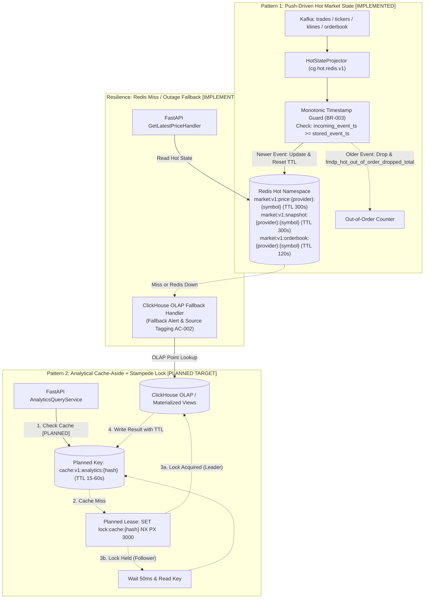

# Diagram 11: Cache Architecture (Hot Push, Analytical Cache-Aside & Stampede Protection) (`DIAG-COMP-011`)

| Diagram Metadata | Value |
|---|---|
| **Diagram ID** | `DIAG-COMP-011` |
| **Title** | Cache Architecture (Hot Push & Planned Stampede Protection) |
| **Diagram Category** | `docs/diagrams/backend/` |
| **Notation / Mermaid Type** | `Mermaid (flowchart TB)` |
| **Status** | `PARTIALLY_IMPLEMENTED` (Pattern 1 Hot State & ClickHouse fallback `[IMPLEMENTED]`; Pattern 2 `lock:cache:{hash}` stampede keys `[PLANNED]`) |
| **Version** | `1.1.0` |
| **Authoritative Document Reference** | `docs/architecture/05-backend-architecture.md`, `docs/architecture/13-performance-and-scalability.md` |
| **Canonical Model Reference** | `models/architecture/components.yaml`, `models/requirements/requirements.yaml` |
| **Related Artifact IDs** | `BR-003`, `AC-002`, `NFR-001`, `TC-002`, `TC-007` |

## Architectural Explanation

The **Cache Architecture Diagram** distinguishes active Redis hot-path projection from the planned analytical stampede-protection pattern:

1. **Pattern 1 — Push-Driven Hot State (`market:v1:*`, `[IMPLEMENTED]`)**:
   - Populated by `HotStateProjector` (`cg.hot.redis.v1`) with monotonic timestamp enforcement (`BR-003`: atomic Lua check `if tonumber(ARGV[1]) >= tonumber(current_event_time) then ... end`, dropping out-of-order stale events and incrementing `fmdp_hot_out_of_order_dropped_total`).
   - On cache miss or Redis unavailability, `GetLatestPriceHandler` falls back to ClickHouse (`AC-002`).
2. **Pattern 2 — Pull-Driven Analytical Cache-Aside with Stampede Lock (`cache:v1:analytics:*`, `[PLANNED / DESIGNED PATTERN]`)**:
   - Designed target for repeatable expensive analytical aggregations using short distributed leases (`SET lock:cache:{hash} 1 NX PX 3000`); not yet wired into active analytics routers (see `13-performance-and-scalability.md`).

